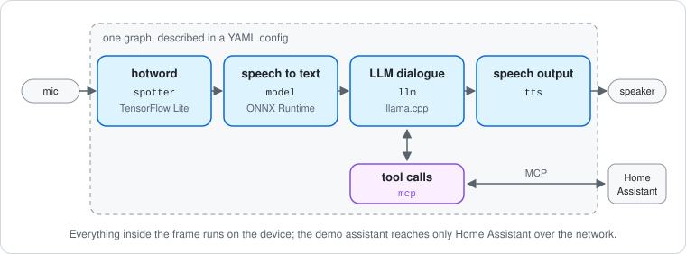
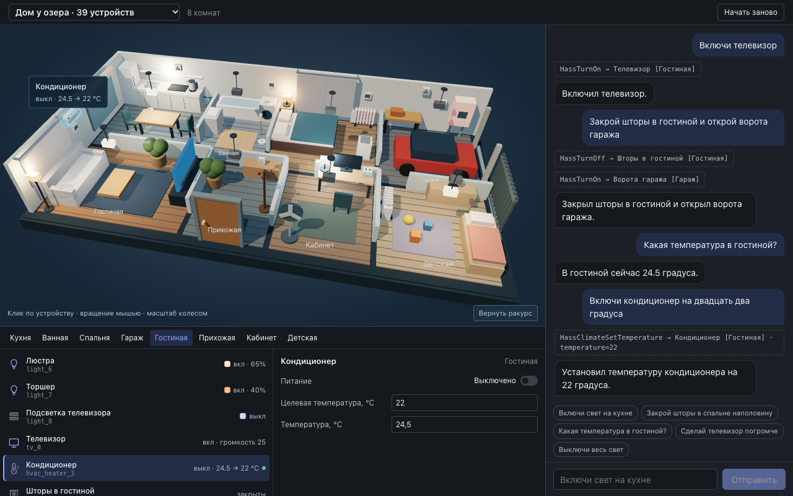
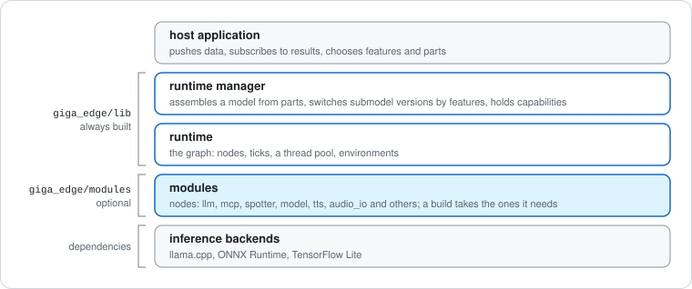
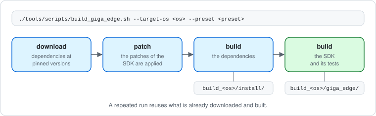

[](https://huggingface.co/ai-sage/GigaEdge-LLM)
[](https://huggingface.co/ai-sage/GigaEdge-Models)
[](LICENSE)

A C++17 framework for on-device voice assistants. An assistant is a graph of nodes described in a YAML config:
hotword spotting, speech recognition, LLM dialogue with tool calls over MCP, speech output. The graph runs locally,
with llama.cpp, ONNX Runtime and TensorFlow Lite as inference backends.



- **A config instead of code.** The assistant is a YAML file that says which nodes run and how they are connected. To
  change how it works, edit the file: nothing is rebuilt.
- **Parallel, yet predictable.** Nodes run on a thread pool, but the graph moves in ticks, one per portion of input. A
  node always gets all its inputs of a tick together, so the result does not depend on which thread was faster.
- **Memory without cycles.** A node can hand a value over to the next tick. That is how the graph remembers the
  dialogue or repeats a step while it stays a graph without cycles.
- **Changes on the fly.** Parts of the graph are loaded, replaced and removed while it runs, without stopping it.
- **Only what you need.** A model is put together from submodels (hotword, speech recognition, dialogue) that
  different products share, and the SDK is built with just the modules a product uses.

## Models

> **The models of the voice assistant are on Hugging Face, under the MIT license:**
>
> | Repository | What is inside | Size |
> |---|---|---|
> | 🤗 [**ai-sage/GigaEdge-LLM**](https://huggingface.co/ai-sage/GigaEdge-LLM) | the function-calling LLM that controls the house | 91 MB |
> | 🤗 [**ai-sage/GigaEdge-Models**](https://huggingface.co/ai-sage/GigaEdge-Models) | the wake word «Гига Ёж», speech recognition ([GigaAM v4](https://huggingface.co/ai-sage/GigaAM-v4), int8), end of utterance, speech synthesis | 542 MB |
>
> How to download them: [step 2 of the example](example/offline_assistant/README.md#2-models).

## Quickstart: a voice assistant for Home Assistant

[example/offline_assistant](example/offline_assistant/README.md): say «Гига Ёж» and a command in Russian, and a local
LLM controls the devices of a house over MCP and answers aloud. The house is your Home Assistant or, with nothing to
set up, a virtual house that speaks the same protocol and shows itself on a 3D page:

- **[Try it in the virtual house](example/offline_assistant/README.md#3-run-in-the-virtual-house)**: build the demo
  and talk to a 3D house in the browser; nothing to set up.
- **[Connect your Home Assistant](example/offline_assistant/README.md#4-run-with-your-home-assistant)**: the same
  assistant controls the real devices of your house.



Build the SDK and the demo:

```bash
git clone https://github.com/salute-developers/giga-edge-sdk.git giga-edge-sdk && cd giga-edge-sdk
./build_demo.sh
```

The script detects the OS of your machine (`macos_arm64`, `macos_x64` or `linux_x86_64`; `OS=<os> ./build_demo.sh`
sets another one), downloads the [models](#models) with the `hf` command (`brew install hf`, or
`pip install -U huggingface_hub` on Linux), then the dependencies at pinned versions from their public repositories.
It applies the patches of the SDK to them, builds them, the SDK and the demo: about 30 minutes on the first run. The
separate steps are in [step 1](example/offline_assistant/README.md#1-build) of the example.

Start the assistant in the virtual house:

```bash
example/offline_assistant/virtual_house/run.sh            # type requests on the page
example/offline_assistant/virtual_house/run.sh --voice    # the microphone: «Гига Ёж, включи свет в спальне»
```

Open <http://127.0.0.1:8124/> when the terminal prints `model loaded` and ask «включи свет в спальне»: the lamp lights
up on the page, and the dialogue shows every call the assistant made. The house needs Python 3.9+ and, once, Node.js
20.19+ or 22.12+ to build the page; two houses come with it, and a new one is a JSON file:
[virtual_house/README.md](example/offline_assistant/virtual_house/README.md).

## Architecture

The core is the **runtime**: a thread-safe graph of nodes. A node is a small reactive operation with typed inputs,
outputs and params; it runs as soon as all its inputs have values for the current tick. Nodes are connected by named
edges, run on a shared thread pool and use shared resources (thread pools, service connections) declared as
environments. The host pushes values into the graph inputs (one push into each input makes a tick) and subscribes to
any edge to get results.

On top of it, the **runtime manager** assembles a model from parts. The top-level graph has slots called submodels.
Their implementations, versions, live in separate configs and are switched by features while the graph runs.
Capabilities attach host services to the graph, for example an MCP client that gives the LLM its tools.

The code is in two places: `giga_edge/lib` is the infrastructure and is always built, `giga_edge/modules` holds the
optional modules that provide nodes. A module left out of a build is replaced by a stub.



## Building

One command builds the dependencies and the SDK:

```bash
./tools/scripts/build_giga_edge.sh --target-os <os> --preset <preset>
```



| Preset | Modules | Backends |
|---|---|---|
| [`opensource`](cmake/presets/opensource.cmake) | all the modules below | llama.cpp, ONNX Runtime, TensorFlow Lite, ncnn |
| [`offline_assistant`](cmake/presets/offline_assistant.cmake) | what the demo assistant needs: all but `audio`, `enhance` and `fst` | llama.cpp, ONNX Runtime, TensorFlow Lite |

The results are in `build_<os>/`: `install/` holds the built dependencies and `giga_edge/` the build of the SDK with
its tests (run them with `ctest --test-dir build_<os>/giga_edge`). A repeated run reuses what is already downloaded
and built.

Two notes on the tests:

- A cross build (`linux_aarch64`, `android_arm64`) needs an emulator for them, because Catch2 lists the tests by
  running the test binaries during the build. Pass
  `--build-tests --giga-edge-args "-DCMAKE_CROSSCOMPILING_EMULATOR=<wrapper>"`, where `<wrapper>` is a script, with no
  spaces in its path, that runs `qemu-aarch64 -L <sysroot> "$@"`. On Android it also needs the bionic of a device and
  a writable `TMPDIR`. Tests that start child processes need binfmt for aarch64 as well.
- With `http_proxy` or `ALL_PROXY` in the environment, the `web_transport_curl` tests need
  `NO_PROXY=127.0.0.1,localhost`.

| `--target-os` | Needs |
|---|---|
| `linux_x86_64` | GCC 11+, CMake 3.26+, git, Python 3, perl, make or ninja; for example Ubuntu 24.04 |
| `linux_aarch64` | cross-compilation with `tools/cmake/linux_aarch64.toolchain.cmake` and `aarch64-linux-gnu-gcc`, `-g++`, `-ar`, `-ranlib` in `PATH` (GCC, or clang wrappers under these names); sysroot in `GIGA_EDGE_SYSROOT` |
| `macos_arm64`, `macos_x64` | Xcode or Command Line Tools, CMake 3.26+; on `macos_x64` (Intel) the LLM runs on the CPU and needs AVX2 |
| `ios_arm64` | Xcode, CMake 3.26+ |
| `android_arm64` | Android NDK r29 (`--ndk-root`) |
| `windows_x64` | Git Bash, MSVC 2022, Ninja |

ONNX Runtime (both presets) is downloaded from the fork [intel/onnxruntime](https://github.com/intel/onnxruntime),
since upstream onnxruntime is no longer on GitHub. Another repository with the same commit can be given in the
environment:
`GIGA_EDGE_ORT_REPO=<address> ./tools/scripts/build_giga_edge.sh --target-os <os> --preset offline_assistant`.

The `enhance` module (preset `opensource`) is built on
[GigaEdge Enhance](https://github.com/salute-developers/giga-edge-enhance). Downloading it needs
[Git LFS](https://git-lfs.com), and it downloads its own dependencies when the SDK is configured.

Useful options (`--help` lists all):

| Option | Meaning |
|---|---|
| `--preset <name or path>` | `opensource`, `offline_assistant` or the absolute path of your own preset file |
| `--module "<modules>"` | modules to build instead of a preset; their dependencies are added |
| `--build-giga-edge-only` | rebuild only the SDK when the dependencies are already built |
| `--build-type Debug` | debug build; `Release` by default |
| `--build-tests`, `--skip-tests` | build the tests or not; built by default except on ios, android and linux_aarch64 |
| `--giga-edge-args "<args>"` | extra CMake arguments for the SDK, for example `-DCOMPILE_SHARED_RUNTIME=ON` |

Another project can use the SDK in two ways:

- **As a subproject**: set `PRESET` or `MODULES`, add `build_<os>/install` to `CMAKE_PREFIX_PATH`, call
  `add_subdirectory(<sdk>)` and link the target `giga_edge_runtime`.
- **Installed**: build the SDK with `--giga-edge-args "-DCOMPILE_SHARED_RUNTIME=ON"` and run
  `cmake --install build_<os>/giga_edge --prefix <sdk prefix>`. In your project, call
  `find_package(giga_edge_runtime CONFIG REQUIRED)` and link `giga_edge::giga_edge_runtime`.

`example/offline_assistant` is built the first way. Either way, call `giga_edge::EnsureNodesRegistered()` before
loading a model. What stays compatible between releases is described in [docs/versioning.md](docs/versioning.md).

## Modules

Each directory of `giga_edge/modules/` is a module:

| Module | What it gives |
|---|---|
| `assistant_core` | assistant contracts (requests, streamed chunks, results) and dialogue nodes: request building, history, stream assembly, sessions |
| `llm` | local LLM on llama.cpp: prompt templates, KV cache reuse between turns, streaming, tool call parsing |
| `mcp` | MCP client capability and nodes: tool catalog, scene, actions |
| `function_calling` | tool results for a compact function-calling model |
| `personalization` | assistant persona and its system prompt |
| `web`, `web_transport_curl` | HTTP transport: the interface and its curl implementation |
| `mcp_http`, `smart_home_ha` | MCP over HTTP and Home Assistant as an MCP server |
| `spotter`, `events` | hotword spotting and its events |
| `model`, `features` | neural network inference on ONNX Runtime, TensorFlow Lite and ncnn; audio features |
| `audio`, `audio_io` | audio processing nodes; microphone and speaker |
| `tts`, `synthesis_text` | speech output and the text sent to it: neural synthesis of Russian (`vits`) or playing pre-synthesized phrases; another engine plugs in as a directory of `tts` |
| `fst` | grammars on OpenFst |
| `enhance` | speech enhancement on GigaEdge Enhance: denoising, echo cancellation, loudness and dynamics control |
| `common` | general-purpose nodes |

To add a module, see [docs/writing-a-module.md](docs/writing-a-module.md).

## Documentation

- [Graph configuration](docs/configuration.md): nodes, edges, environments, submodels.
- [Writing a node](docs/writing-a-node.md): ports, params, registration, tests.
- [Writing a module](docs/writing-a-module.md): `module.cmake`, dependencies, stubs, tests.
- [Versioning](docs/versioning.md): the public API and the compatibility of submodel versions and parts.
- The core: [the libraries](giga_edge/lib/README.md), [node](giga_edge/lib/node/README.md),
  [runtime](giga_edge/lib/runtime/README.md), [runtime_manager](giga_edge/lib/runtime_manager/README.md).
- Modules: [llm](giga_edge/modules/llm/README.md), [tts](giga_edge/modules/tts/README.md),
  [smart_home_ha](giga_edge/modules/smart_home_ha/README.md), and for `model` the
  [inference strategies](giga_edge/modules/model/src/nodes/model/inference_strategies/README.md) and the
  [ncnn backend](giga_edge/modules/model/src/backends/ncnn/README.md).
- The example: [the offline assistant](example/offline_assistant/README.md) and its
  [virtual house](example/offline_assistant/virtual_house/README.md).

## Contributing and security

See [CONTRIBUTING.md](CONTRIBUTING.md) and [SECURITY.md](SECURITY.md).

## License

MIT, see [LICENSE](LICENSE). Third-party components and their licenses: [NOTICE](NOTICE).
