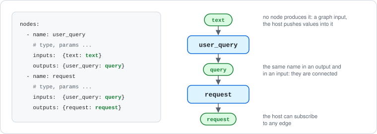
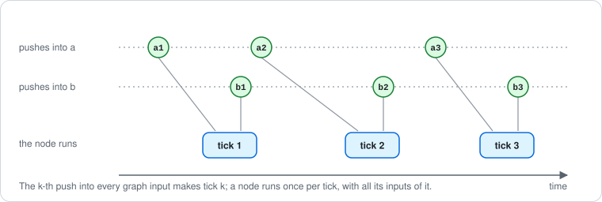
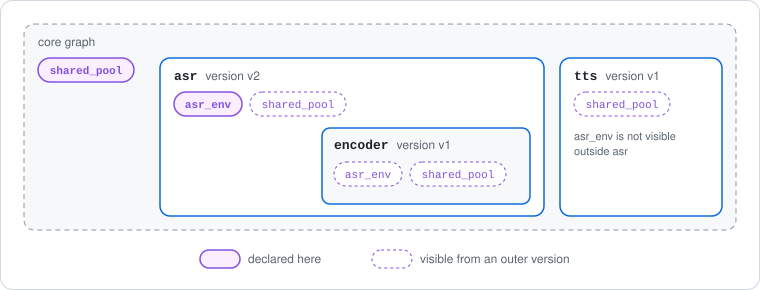
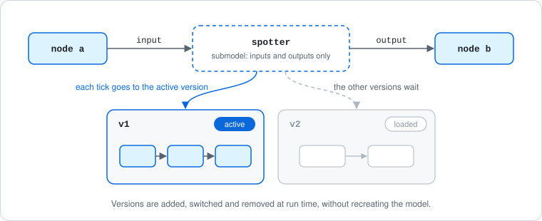
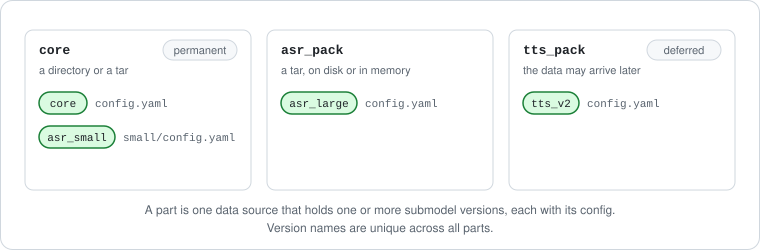

# Graph configuration

A model is described by a YAML config: which nodes run, how their inputs and outputs are wired, which shared resources
they use and which parts of the graph can be swapped at run time. Changing the config changes the pipeline without
rebuilding the SDK. For complete examples, see the configs of the demo voice assistant: they come with its models from
[Hugging Face](https://huggingface.co/ai-sage/GigaEdge-Models), and the tests keep copies of them in
[giga_edge/modules/assistant_core/tests/data/demo/model](../giga_edge/modules/assistant_core/tests/data/demo/model/).

## Top level

```yaml
version: my_model        # name of this config
lib_version: "1.0"       # required: config format version, see versioning.md
num_threads: 2           # required: size of the graph's thread pool; with 0, nodes run on the thread that pushes data
load_threads: 1          # how many submodel versions of one nesting level are built in parallel
realtime_priority: false # give realtime priority to the pool threads
num_realtime_threads: 0  # ... or only to this many of them
thread_name_prefix: ""   # name prefix for the pool threads
common_node_params: {}   # latency statistics, see the runtime README

model_environments: {}   # shared resources, see "Environments"
nodes: []                # see "Nodes"
submodels: []            # see "Submodels and versions"
default_submodels: {}
features: []
```

## Nodes

A node is the smallest unit of work in the graph. Each entry picks a registered node type, gives the instance a
unique name and connects its ports to edges of the graph:

```yaml
nodes:
  - type: user_query_from_text   # registered node type
    name: user_query             # unique within the graph
    inputs: {text: text}         # <node input>: <edge>
    outputs: {user_query: user_query}  # <node output>: <edge>
    params: {request_id_prefix: "q-"}  # node-specific, parsed by the node
    priority: 0                  # a higher priority runs first when the pool is busy
```

- **Edges** are just names. An output and every input that use the same edge name are connected. An edge that no
  node produces is an input of the graph: the host pushes values into it. The host can subscribe to any edge.
- **Ticks.** One push into every graph input makes one tick. A node runs once all its connected inputs have a value
  for the tick, and pushes one value (or one batch) into each of its outputs.
- **Optional inputs** may be left out of the config. All the others must be connected.
- **Batch outputs** emit one or more values per tick (for example, a stream of LLM chunks); a **batch input**
  receives the whole batch at once.
- **Recursive outputs** feed a value into the *next* tick. This is how the graph keeps state across ticks without
  cycles: `dialogue_state_update` writes `dialogue_history`, and `dialogue_request_builder` reads it on the next turn.





The ports of a node, their types and its params are documented where the node is registered (see "Node reference").
For pictures of batch and recursive ports, see the [node README](../giga_edge/lib/node/README.md).

## Environments

An environment is a resource shared by nodes: a thread pool, a connection to a service, a session of an inference
runtime. Environments are declared once and referenced from node params by name:

```yaml
model_environments:
  llm_pool:
    type: thread_pool
    thread_pool: {threads_count: 1, realtime_priority: false, thread_name_prefix: llm}

nodes:
  - type: llm_generate
    name: llm
    # ...
    params:
      inference_strategy: {type: wait_till_inferring, thread_pool_name: llm_pool}
```

`thread_pool` and `empty` are built in; modules register more types (for example, `onnx`, `mcp` and `web`). The host
can also pass ready-made environments to `RuntimeManager`; the graph sees them under their names.

`model_environments` can also be declared in the config of any submodel version. Such an environment is visible to
the nodes of that version and of every version nested in it. If a nested version declares an environment with the
same name, its own one is used inside it.



## Submodels and versions

A submodel is a slot in the graph with a fixed interface. Its implementation, a *version*, is a separate config with
its own nodes. Versions are loaded from model parts and can be switched while the graph runs.



```yaml
submodels:
  - id: choice
    inputs: {input: text}        # <submodel input>: <edge of this graph>
    outputs: {text: choice_text} # <submodel output>: <edge of this graph>

default_submodels:
  choice: {submodel_version: choice.default}

features:
  - feature_ids: [experimental]  # version used while this feature is on
    submodel_id: choice
    submodel_version: choice.experimental
    require_mode: none
```

Inside a version, the names of the interface are ordinary edges:

```yaml
version: choice.default
lib_version: "1.0"   # optional in a version config; checked like the top-level one when stated
nodes:
  - type: some_node
    name: impl
    inputs: {value: input}
    outputs: {result: text}
```

`RuntimeManager` takes the core part (the top-level config) and the parts with versions. It picks a version for
every slot from `default_submodels` and the enabled features, and reports which versions are missing or failed to
build. For details, see the [runtime_manager README](../giga_edge/lib/runtime_manager/README.md).

## Files of a model

A part is a directory (or a tar archive) with configs and the files they refer to
([RuntimePart](../giga_edge/lib/runtime_manager/README.md#runtimepart)). File paths in params, such as
`llm_interpreter_params.model_path`, are relative to the part:

```cpp
RuntimeManager manager(RuntimePart{
  .id = CORE_VERSION_NAME,
  .data = ModelFileData{"path/to/model"},
  .versions = {{CORE_VERSION_NAME, {.config_path = "config.yaml"}}},
});
auto graph = manager.Model();
```



## Node reference

Every node documents itself where it is registered: `REGISTER_NODE` takes a description of the node, and
`REGISTER_INPUT` / `REGISTER_OUTPUT` take a description and a type for each port (see
[writing-a-node.md](writing-a-node.md)). So the header of a node is its reference. To find it, open the `nodes.h` of
the module, `giga_edge/modules/<module>/internal/giga_edge/modules/<module>/nodes.h`: it includes the headers of all
the nodes of the module, with their ports, params and descriptions. How the params are parsed is in the sources of
the module, under `src/`. The nodes of the `llm` module are also described in the
[llm README](../giga_edge/modules/llm/README.md).
