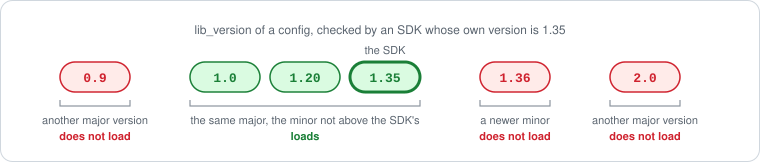

# Public API and versioning

This document says what the public API of the SDK is, and how to tell whether a submodel version or a part works with
a given SDK build.

## Public API

An application uses the SDK in two ways: it calls C++ code and it loads graphs. The public API covers both:

- **C++ headers under `include/`** of the components: `giga_edge/lib/<lib>/include/` and
  `giga_edge/modules/<module>/include/`, plus `giga_edge/nodes/include/` (`EnsureNodesRegistered`). These are the
  headers installed with `-DCOMPILE_SHARED_RUNTIME=ON`. The main entry points are `RuntimeManager`
  (`giga_edge/lib/runtime_manager`) and the types an application pushes into a graph and reads from it, such as the
  assistant contracts of `assistant_core`.
- **The CMake interface**: the targets `giga_edge_runtime` (SDK as a subproject) and
  `giga_edge::giga_edge_runtime` (installed package `giga_edge_runtime`), the options of the root `CMakeLists.txt`,
  the presets and the options of `tools/scripts/build_giga_edge.sh` ([README](../README.md)).
- **The graph contract**: the config format ([configuration.md](configuration.md)), node type names, their ports with
  value types, their params with defaults, and environment types.

Not part of the public API, and not installed:

- everything under `internal/`, `src/`, `stub/` and `tests/`. This includes the node API (`NodeBase`, `REGISTER_NODE`
  and the port macros): nodes are written inside the SDK tree, as part of a module
  ([writing-a-node.md](writing-a-node.md));
- the CMake helpers for modules (`register_module`, `giga_edge_module`, `add_giga_edge_test`).

The public headers use types of the C++ standard library, so an application must be built with the same toolchain
and build options as the SDK.

## Submodel version

The config of a submodel version states the config format it needs in `lib_version`, as `"major.minor"`. The SDK has
its own config format version (`kLibVersion` in `giga_edge/lib/version/internal/giga_edge/lib/version/version.h`) and
compares the two when the version is loaded: the top-level config when the graph is created, the config of any other
version when that version is added. Two conditions must hold:

- the major versions must be equal;
- the minor version of the config must not be above the SDK's.

Otherwise the version does not load: the error is `Giga Edge SDK runtime version unsupported`, and the SDK prints its
own version to stderr. The top-level config must state a valid `lib_version`. The config of another version may leave
the field out, and then it is not checked.

In other words, a config written for an older minor version loads on a newer SDK of the same major version. A config
that declares a newer minor version than the SDK has, or a different major version, does not load.

## RuntimePart

A part ([RuntimePart](../giga_edge/lib/runtime_manager/README.md#runtimepart)) is a directory or a tar archive with
the configs of submodel versions and the files they refer to, such as weights. Whether a part works with a given SDK
build depends on three things:

- **`lib_version`** of its configs, as above;
- **the modules in the build.** A module left out is a stub, and a graph that uses its nodes fails to load
  ([writing-a-module.md](writing-a-module.md#selecting-modules));
- **the inference backends in the build and their versions.** llama.cpp, ONNX Runtime, TensorFlow Lite and ncnn are
  built at the versions set in `tools/scripts/download_dependencies.sh`. The weights must be in a format that this
  version can read, for example a GGUF file that this llama.cpp supports.
