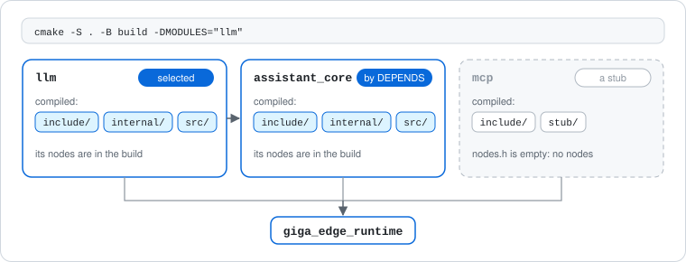

# Writing a module

A module is an optional part of the SDK: a directory under `giga_edge/modules/` that brings nodes for the graph and,
if needed, a small public API for the host. The build includes only the selected modules; the others turn into stubs,
so a device build carries only what its graphs use.

## Layout

```
giga_edge/modules/my_module/
├── module.cmake                    # declares the module: dependencies, packages, default set
├── CMakeLists.txt                  # builds the target my_module_module
├── include/giga_edge/modules/my_module/
│   └── my_api.h                    # public headers, installed with the SDK (optional)
├── internal/giga_edge/modules/my_module/
│   ├── nodes.h                     # includes every node header of the module
│   └── nodes/my_node/node.h
├── src/
│   ├── my_api.cpp
│   └── nodes/my_node/node.cpp
├── stub/
│   └── my_api.cpp                  # implementation of include/ when the module is not built (optional)
└── tests/
    ├── CMakeLists.txt
    └── src/my_node.cpp
```

`include/` is the public surface of the module and is installed. `internal/` is visible to the SDK and to other
modules at build time but is not installed. For how to write the node itself, see
[writing-a-node.md](writing-a-node.md).

## `module.cmake`

The build finds modules by their directories. Each module declares itself in its own `module.cmake` with
`register_module` (see `cmake/Module.cmake`); a directory without this file is registered with no properties.

```cmake
register_module(my_module DEPENDS assistant_core PACKAGES openfst)
```

| Key | Meaning |
|---|---|
| `DEPENDS <module>...` | modules that are built together with this one |
| `PACKAGES <package>...` | external libraries of the module, by SDK package name; looked up only when the module is built |
| `DEFAULT` | the module is in the default module set |
| `PROVIDES <package>...` | packages the module builds itself; they are not looked up |
| `AFTER <module>...` | configure and link the module after these ones. Rarely needed: when the module uses the target of another module at configure time. The named modules must not have `AFTER` themselves |

The file must call `register_module` exactly once, with the name of its directory. Real examples:

```cmake
register_module(llm DEPENDS assistant_core)   # giga_edge/modules/llm/module.cmake
register_module(fst PACKAGES openfst)         # giga_edge/modules/fst/module.cmake
```

A package name refers to `cmake/packages/<name>.cmake`, which finds the library and names its targets, so the
module can link them right away:

```cmake
giga_edge_module(fst ... PRIVATE_DEPS OpenFst::fst)   # giga_edge/modules/fst/CMakeLists.txt
```

For a new external library, add `cmake/packages/<name>.cmake` modelled on the existing files. It calls
`find_package` and sets `_targets` (the targets of the library; they become global) and `_bundled` (the static
libraries that a consumer may merge into its own archive).

## `CMakeLists.txt`

The module target is created by the `giga_edge_module` helper:

```cmake
cmake_minimum_required(VERSION 3.14)

giga_edge_module(my_module
  DEPS
    node_lib
    config_parser_lib
    assistant_core_module
  PRIVATE_DEPS
    OpenFst::fst
)
```

- `SRCS`: sources to compile. Without it, every `.cpp` under `src/` is compiled.
- `DEPS`: public dependencies; `PRIVATE_DEPS`: dependencies of the implementation only.
- `STUB_DEPS`: dependencies of the code in `stub/`, used when the module is not selected.
- `tests/` is added automatically when tests are built.

A module that has only `include/` (no sources, no `internal/`, no `stub/`) is header-only: it is always available and
is never stubbed.

A module may have build options of its own, for example a switch for a backend: `llm` has `LLAMA_CPP_ENABLED`. When
`SRCS` is not given, every `.cpp` under `src/` is compiled, the source of the backend too. So such a module lists its
sources and adds the backend source only when the option is on:

```cmake
option(MY_BACKEND_ENABLED "Build my_module with the backend" OFF)

giga_edge_module(my_module
  SRCS
    src/my_api.cpp
    src/nodes/my_node/node.cpp
  DEPS
    node_lib
)

module_enabled(my_module _enabled)
if(_enabled AND MY_BACKEND_ENABLED)
  target_sources(my_module_module PRIVATE src/backend.cpp)
  target_compile_definitions(my_module_module PUBLIC MY_BACKEND_ENABLED=1)
endif()
```

## Selecting modules

```bash
cmake -S . -B build -DMODULES="llm mcp"   # these modules and their DEPENDS
cmake -S . -B build -DMODULES="*"         # every module of the tree
```

A module that is not selected becomes a stub. Its public headers stay available and `stub/*.cpp` provides their
implementation, which usually throws "not supported". Its heavy dependencies are not pulled in, and its `nodes.h` is
replaced by an empty file, so graphs that use its nodes fail to load in such a build.



A preset is a named set of modules and backends: `-DPRESET=<name>` loads `cmake/presets/<name>.cmake`. The preset
`opensource` lists every module of the tree, so add a new module to it.

## Tests

`tests/CMakeLists.txt` declares Catch2 test executables with `add_giga_edge_test`:

```cmake
add_giga_edge_test(
  my_module_tests
  SRCS
    src/my_node.cpp
  LIBS
    my_module_module
    node_test_utils
  DATA data           # optional: tests/data is copied next to the test binary
)
```

Each `TEST_CASE` is registered in CTest and runs in the directory of its binary, so data files are opened by relative
paths (`data/...`):

```bash
cmake -S . -B build -DMODULES=my_module -DCMAKE_PREFIX_PATH=<dependencies>
cmake --build build --target my_module_tests
ctest --test-dir build
```
