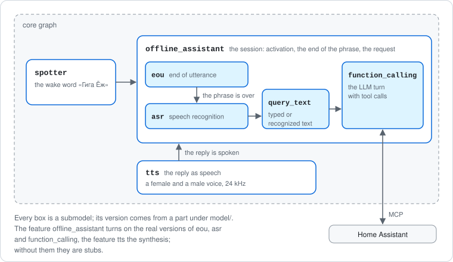

# Offline voice assistant on Home Assistant

Say «Гига Ёж» and a smart home command in Russian. The SDK spots the wake word, recognizes the phrase, a local LLM
picks a Home Assistant function and calls it over MCP. The answer is printed and spoken by the speech synthesis of
the SDK:

```
>> listening…
>> request: включи свет в спальне.
>> answer: Включил свет в спальне.
>> sound: 148 ms after the answer
```

Everything runs on your computer: wake word (TensorFlow Lite), speech recognition GigaAM v4 (ONNX Runtime), end of
utterance (ONNX Runtime), function-calling GigaEdge LLM (llama.cpp), speech synthesis (ONNX Runtime). Only Home
Assistant is reached over the network, and for the first run a virtual house stands in for it (step 3).

The steps below are for macOS on Apple silicon. A Mac with an Intel processor builds the same way with
`OS=macos_x64`: the LLM runs on the CPU there and needs AVX2. Linux (`linux_x86_64`, microphone through `arecord`)
builds the same way with `OS=linux_x86_64`.

## 1. Build

You need Xcode Command Line Tools (`xcode-select --install`), CMake 3.26+ (`brew install cmake`) and git. The first
command downloads and builds the dependencies, which takes about 30 minutes; the demo itself builds in about a minute.
Run from the repository root:

```bash
OS=macos_arm64
./tools/scripts/build_giga_edge.sh --target-os $OS --preset offline_assistant
cmake -S example/offline_assistant -B build/offline_assistant -DCMAKE_BUILD_TYPE=Release \
    -DGIGA_EDGE_DEPS_BUILD=$PWD/build_$OS -DCMAKE_POLICY_VERSION_MINIMUM=3.5
cmake --build build/offline_assistant -j --target offline_assistant_demo
```

For `OS=linux_aarch64` (cross build) add `-DCMAKE_TOOLCHAIN_FILE=$PWD/tools/cmake/linux_aarch64.toolchain.cmake
-DCMAKE_FIND_ROOT_PATH=$PWD/build_$OS/install` to the second command, with the same `GIGA_EDGE_SYSROOT`.

## 2. Models

The models are two repositories on Hugging Face, both under the MIT license:

- [GigaEdge Models](https://huggingface.co/ai-sage/GigaEdge-Models), 542 MB: the wake word, speech recognition,
  end of utterance and speech synthesis. Speech recognition is
  [GigaAM v4](https://huggingface.co/ai-sage/GigaAM-v4) with the encoder quantized to int8.
- [GigaEdge LLM](https://huggingface.co/ai-sage/GigaEdge-LLM), 91 MB: the function-calling model.

The `hf` command downloads them: `brew install hf`, or `pip install -U huggingface_hub` on Linux. Run from the
repository root:

```bash
M=example/offline_assistant/model
hf download ai-sage/GigaEdge-Models --include "*/*" --local-dir $M
hf download ai-sage/GigaEdge-LLM --include "*/*" --local-dir $M
```

The parts come with their graphs and land next to `model/meta.json`, the only file of the model kept in this
repository: it lists the parts.

Speech synthesis is the part `model/tts/`. It has two voices, a female one (`voice_1`) and a male one (`voice_2`).
The sources and licenses of its models and dictionaries are listed in `model/tts/model/NOTICE`, and the files of the
part are described in the [README of the tts module](../../giga_edge/modules/tts/README.md#the-package).

`main.cpp` sets the persona of the assistant through the personalization capability: a male character that
addresses the user formally (на «вы»). The `persona` node of the core (`model/core/config.yaml`) turns the persona
into a line of the system prompt and a voice: `male` speaks with `voice_2`, `female` with `voice_1`. Without a
persona, the synthesis takes the key `voice` of `model/tts/model/config.yaml`.

## 3. Run in the virtual house

No Home Assistant is needed for the first run. A virtual house answers the assistant the way Home Assistant does and
shows itself on a 3D page ([virtual_house/README.md](virtual_house/README.md)). It needs Python 3.9+ and, once,
Node.js 20.19+ or 22.12+ to build the page:

```bash
example/offline_assistant/virtual_house/run.sh            # type requests on the page
example/offline_assistant/virtual_house/run.sh --voice    # the microphone: «Гига Ёж, включи свет в спальне»
```

Open <http://127.0.0.1:8124/> when the terminal prints `model loaded`.

## 4. Run with your Home Assistant

Any Home Assistant 2026.9 or newer:

1. Settings → Devices & services → Add integration → **Model Context Protocol Server**.
2. Settings → Voice assistants → Expose: choose the devices for the assistant. It handles lights, switches, covers
   and valves, climate, fans, humidifiers, TVs, temperature and humidity sensors and door, motion, smoke, gas and leak
   sensors; the exact rules are in the README of the
   [Home Assistant adapter](../../giga_edge/modules/smart_home_ha/README.md). GigaEdge LLM is Russian: devices and
   areas need Russian names; devices with the same name in the same area are left out.
3. Your profile → Security → Long-lived access tokens → Create token, then in the terminal:

   ```bash
   read -rs GIGA_EDGE_HA_TOKEN && export GIGA_EDGE_HA_TOKEN     # paste the token, Enter
   HA=http://<host>:8123/api/mcp/assist
   ```

   With a proxy in the environment, keep Home Assistant off it: `export NO_PROXY=<host>`.
4. Put the area where you are into `current_room` of the `ha_catalog` node in
   `model/function_calling/model/config.yaml`, spelled as in Home Assistant: requests without a room go there. An
   empty value means no room, and a name that is not an area of the house is reported in `demo.log`. A repeated
   download of the models (step 2) puts the file back as it was, so set the room again after it.

Then start the demo:

```bash
B=build/offline_assistant/offline_assistant_demo
M=example/offline_assistant/model
$B --ha-url $HA $M 2>demo.log          # microphone: «Гига Ёж, включи свет в спальне»; Ctrl-D to exit
$B --ha-url $HA --text $M 2>demo.log   # type requests, one per line
```

- On the first run macOS asks to allow the terminal to use the microphone.
- The wake word is «Гига Ёж», «Гига Ёжик», «Ёж» or «Ёжик». If it is missed, press Enter and say the command.
- When the assistant asks a clarifying question, it listens again by itself once the question has been played:
  answer without the wake word.
- For the length of a spoken answer and a moment after it, the wake word is off (with `--mute` as well), so the
  assistant does not take its own answer for a request. Enter works at any time.
- Answers are synthesized at 24 kHz, and the first sound comes a fraction of a second after the answer (the line
  `>> sound:`). `--mute` turns the sound off, and `--save-audio reply.wav` writes the synthesized answers to a file
  when the demo exits.
- If the demo exits at once, the reason is at the end of `demo.log`: no token in this terminal, a wrong URL, or the
  models are not downloaded. `demo.log` also lists every MCP call.
- Home Assistant is reread every 60 s, so renamed or newly exposed devices appear without a restart.
- `--wav phrase.wav` takes a recording instead of the microphone: 16 kHz mono PCM16.

## What to ask

Phrases to try: «включи свет в спальне», «выключи свет», «поставь яркость пятьдесят процентов», «открой жалюзи на кухне
наполовину», «поставь кондиционер на двадцать два градуса», «какая температура в гостиной», «выключи весь свет»,
«выключи свет на кухне и закрой жалюзи на кухне». A value is copied from one device to another by «сделай яркость
торшера как у люстры». A scene or a script of Home Assistant is run by «включи сценарий <its name>»: the model sees
it as «Сценарий <its name>», and without that word it often takes «включи спокойной ночи» for music or for small
talk.

What the assistant cannot do yet, such as locks and the direction of a fan, and which values cannot be copied is
listed in the README of the [Home Assistant adapter](../../giga_edge/modules/smart_home_ha/README.md).

## Report a problem

When the assistant gets a request wrong, type `/report` and what went wrong in the terminal of the demo, with or
without the microphone: `/report свет не включился`. On the page of the virtual house it is «Сообщить о проблеме».
The demo answers `>> report: <file>` and writes one JSON file to `bug_reports/` in the current directory
(`--report-dir <dir>` sets another): the time, the comment, the house as the model sees it (`scene`: the devices and
their parameters, the text that goes into the prompt), and the versions of the model. The file stays on this
computer: the demo sends it nowhere, and it holds no token, address, sound or log. Without the function-calling model
there is no scene, and the demo says so instead of writing a file.

## Files

The model of the demo is put together from submodels:



| Path | What |
|---|---|
| `main.cpp` | the client: loads the model, connects Home Assistant over MCP, feeds microphone, wav or text, plays the answer |
| `bug_report.{h,cpp}` | problem reports: keeps the latest scene of the house and writes it to a file on `/report` |
| `model/meta.json` | the list of the parts; the parts themselves come from Hugging Face (step 2) |
| `model/core/config.yaml` | core graph: wake word slot `spotter`, MCP environment, session slot `offline_assistant`, synthesis slot `tts`, which speaks the reply of the session |
| `model/spotter/`, `model/asr/`, `model/eou/` | wake word, speech recognition, end of utterance |
| `model/offline_assistant/` | session logic: activation, recognition, end of utterance, request to the LLM |
| `model/function_calling/` | the turn of GigaEdge LLM with tool calls; the house comes from Home Assistant (`ha_*` nodes) |
| `model/tts/` | speech synthesis: the graph, the voices, `NOTICE` and the licenses |
| `virtual_house/` | a virtual house with a 3D page instead of Home Assistant |
| `../../cmake/presets/offline_assistant.cmake` | the preset: modules and backends of the build |
