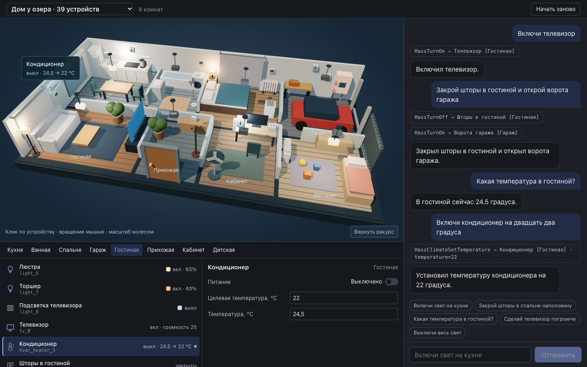
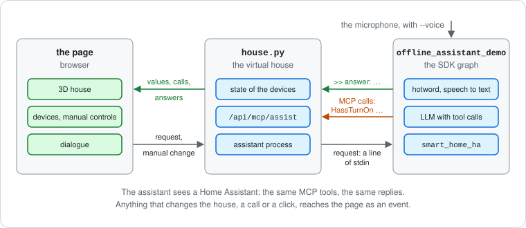
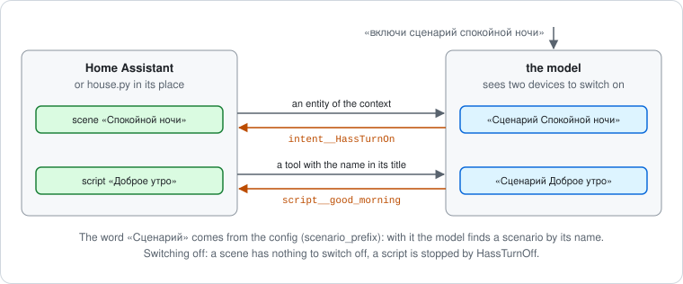
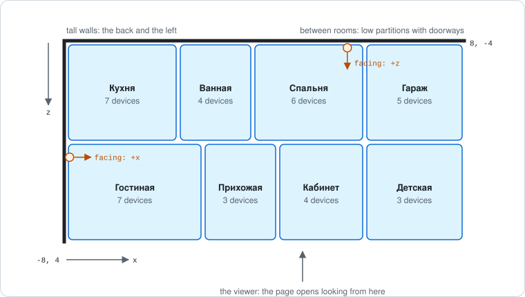

# Virtual house

A house for the offline assistant demo that needs neither Home Assistant nor Docker. One Python process keeps the state
of a virtual house, answers the assistant the way the Model Context Protocol Server of Home Assistant does, and shows
the house on a 3D page. Type «включи свет в спальне» or say it after «Гига Ёж», and the lamp lights up on the page. Two
houses come with it: a lake house with 40 devices in 8 rooms and a city apartment with 17 devices in 4 rooms, each
with a scene and a script.



`house.py` stands between the page and the assistant: it starts `offline_assistant_demo`, passes it the requests typed
on the page and answers its MCP calls from the state of the house.



## Run

Build the demo and get its models first: steps 1 and 2 of [../README.md](../README.md). The house needs Python 3.9+
and, once, Node.js 20.19+ or 22.12+ with access to the npm registry to build the page. From the repository root:

```bash
example/offline_assistant/virtual_house/run.sh            # type requests on the page
example/offline_assistant/virtual_house/run.sh --voice    # the microphone: «Гига Ёж, включи свет в спальне»
```

Open <http://127.0.0.1:8124/> when the terminal prints `model loaded`. `run.sh` builds the page on the first start,
starts the house and starts `offline_assistant_demo` connected to it; Ctrl-C stops both.

- The right column is the dialogue: the request, every call the assistant made to the house, the answer. A click on a
  call selects its device; more than three calls in a row fold into one line that counts them, and a click opens it.
  With `--voice` the recognized request appears there too.
- «Сообщить о проблеме» under the dialogue saves the house as the assistant sees it, with the comment next to the
  button, and the dialogue shows the path of the file: [Report a problem](../README.md#report-a-problem).
- The list at the top switches the house. The assistant is started anew on a switch, which takes about a second: it
  reads the house once, at its start, and its dialogue is about the old house.
- A device is selected by a click on the scene or in the list; its controls change it by hand. Sensors only change
  this way: open «Входная дверь» or raise «Датчик температуры в гостиной», then ask «открыта ли входная дверь».
- Requests without a room go to «Гостиная»: it is `current_room` of the model, see step 4 of [../README.md](../README.md).
  The speaker of the assistant stands there; its ring glows while the assistant waits and comes alive while it
  listens, thinks and answers.
- The log of the assistant, with every MCP call, is `virtual_house.log` next to `run.sh`.
- `PORT`, `HOUSE`, `DEMO` and `LOG` in the environment change the port, the house to start with (`lake_house` or
  `apartment`), the path of the built demo and the log file; the model directory is the last argument of `run.sh`.

Phrases to try: «включи свет в спальне», «выключи весь свет», «сделай люстру ярче», «закрой шторы в спальне
наполовину», «открой ворота гаража», «поставь тёплый пол на двадцать восемь градусов», «включи телевизор и сделай
громкость тридцать», «какая температура в спальне», «включи чайник и закрой кран воды», «включи сценарий спокойной
ночи».

## The house

| Home Assistant domain | Devices | What the assistant does |
|---|---|---|
| `light` | ceiling lights, floor and table lamps, night lights, LED strips | on and off, brightness, colour, colour temperature |
| `vacuum` | robot vacuum | starts cleaning, returns to base, reads its state |
| `switch` | kettle, sockets, pump relay | on and off |
| `climate` | air conditioner, radiator, heater, boiler, underfloor heating | on and off, target temperature, reads the temperature |
| `cover` | curtains, blinds, garage gate | open, close, position |
| `valve` | water valve | open and close |
| `media_player` | TV | on and off, volume, mute |
| `fan`, `humidifier` | fan, humidifier | on and off |
| `sensor`, `binary_sensor` | temperature, humidity, door, motion, smoke, gas, water leak | reads the value |
| `scene`, `script` | «Спокойной ночи» and «Доброе утро» in the lake house, «Кино» and «Я ушёл» in the apartment | runs it |

A scene or a script is run by «включи сценарий <its name>»: «включи сценарий спокойной ночи» switches every light of
the lake house off and its fan on. The word «сценарий» is what makes it reliable: without it the model often takes
the name for music or for small talk. As in Home Assistant, the scene is an entity among the devices, and the script
is only a tool of its own, `script__<id>`.



What the assistant can and cannot do with these devices is decided by the
[Home Assistant adapter](../../../giga_edge/modules/smart_home_ha/README.md), as with a real Home Assistant. The house
itself is simple: drives arrive at once, a heater does not warm the room, and a script is over the moment it starts.

Every light, including strips and night lights, has `light_colour`: an `R;G;B` string or `null` (white light).
`HassLightSet` accepts `color` from [HA's named palette](https://github.com/home-assistant/core/blob/2026.11.0/homeassistant/util/color.py),
stored in `colours.json`; matching ignores spaces and case, and unknown names fail. Setting `temperature` clears
colour, while brightness preserves it. Colour and temperature cannot be set together. The live context of a light that
is on reports its colour as `rgb_color` or, for white light, its warmth as `color_temp_kelvin`. So the assistant can
copy a colour from one lamp to another, name the colour of a lamp and make the light warmer or colder.

Each house also has a robot vacuum (`type: vacuum_cleaner`). Its position is the dock; `on_off` means cleaning,
and `battery_percentage` is a read-only reading for the page. `HassVacuumStart` starts it and
`HassVacuumReturnToBase` docks it immediately. Its HA context reports `cleaning` or `docked`, without battery level,
as HA's context filter omits charge. The assistant therefore cannot read its charge through this adapter.

`house.py` alone is the house without an assistant. Its MCP endpoint `http://127.0.0.1:8124/api/mcp/assist` takes any
token, so an assistant started separately works as with a real Home Assistant, and the page shows what it does. Such
an assistant learns about a switch of the house as about any change in Home Assistant: when it rereads the context,
within a minute.

```bash
python3 example/offline_assistant/virtual_house/house.py
export GIGA_EDGE_HA_TOKEN=any NO_PROXY=127.0.0.1
build/offline_assistant/offline_assistant_demo --ha-url http://127.0.0.1:8124/api/mcp/assist example/offline_assistant/model
```

The house listens on `127.0.0.1` only and has no authentication: `--host` opens it to the network as it is.

## Call events

Every MCP `tools/call` publishes one `call` event, including reads, unchanged targets and errors:
`{type: "call", tool, arguments, changed: [...device_ids], is_error: false, background: false}`.
A failure adds an `error` string; a script call adds its `title`. A failed read with no match also marks the
event as an error. A changed target produces a `values` event after `call`.

`background: true` marks unfiltered `GetLiveContext` and `resources/read` of the context snapshot (the latter uses
`tool: "resources/read"`, `arguments: {uri: "homeassistant://assist/context-snapshot"}`). Targeted reads remain
visible: the MCP request cannot tell a user question from the adapter's check before a write.

## Your own house

A house is a file of [houses/](houses): its name, rooms and devices. `house.py` and the page read everything from
it, so a new file there is a new house in the list of the page; `--house <file name>` starts with it. The plan of
[houses/lake_house.json](houses/lake_house.json):



- A room is a rectangle on the plan: the centre `x`, `z` and the size `w`, `d` in metres, the `floor` colour. Rooms
  that share an edge get a low partition with a doorway; the tall walls are at the back (`-z`) and on the left (`-x`).
- A device has what Home Assistant would report (`domain`, `device_class`, `name`, `area`, the initial `values`) and
  what the page draws: `pos` is `[x, height, z]`, `kind` is the 3D model when the domain has several (`led_strip`,
  `kettle`, `relay`, `hvac_ac`, `hvac_radiator`, `hvac_boiler`, `hvac_underfloor_heating`), `facing` is where its front
  looks (`+x` by default, `+z` is towards the viewer). `length`, `size`, `mount`, `base` and `slide` shape some models:
  see how the bundled house uses them. The `values` of a light are `on_off`, `light_brightness`, `light_colour_temp`
  and `light_colour` (`null` while it is white).
- `assistant` places the speaker of the assistant on the page: `{"area": "Гостиная", "pos": [x, height, z]}`, where
  `area` is the room named in `current_room` of the model. Without it the page draws no speaker.
- An entry of `scenarios` is a `scene` or a `script` of Home Assistant. It has a `name`, an `id` (the object id; the
  tool of a script is `script__<id>`) and `set`: what it does, as a list of targets with the `values` each of them
  gets. A target is chosen the way Home Assistant does it, by any of `name`, `area` and `domain`:
  `{"domain": "light", "values": {"on_off": false}}` is every light. The page offers «включи сценарий <name>» among
  its examples.
- The model is Russian: name the devices and the rooms in Russian. A name must be unique within its domain, and the
  house needs the room named in `current_room`. `python3 -m unittest test_house` checks both for every house.

The furniture is decoration and lives in [web/src/scene/furniture.ts](web/src/scene/furniture.ts), by the file name of
the house; a house without furniture there is just empty. After a change in `web/` rebuild the page: `npm run build`
there, or `npm run dev` for a live page next to a running `house.py`.

## Files

| Path | What |
|---|---|
| `house.py` | the server: the state of the house, the Home Assistant dialect of MCP, the API of the page, the assistant process |
| `houses/` | the houses: the rooms, the devices and the scenarios of each |
| `test_house.py` | checks of the replies against the ones recorded from a live Home Assistant |
| `run.sh` | builds the page, starts the house and the assistant |
| `web/` | the page: React, TypeScript, Three.js, built with Vite; the scene is generated in code, without model files |
| `images/` | the pictures of this README |
