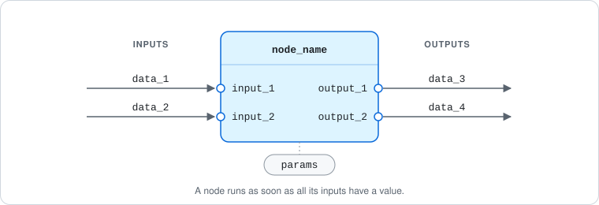
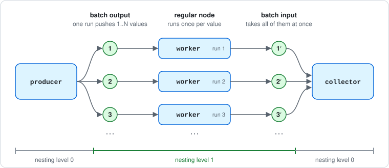
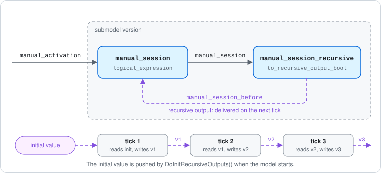
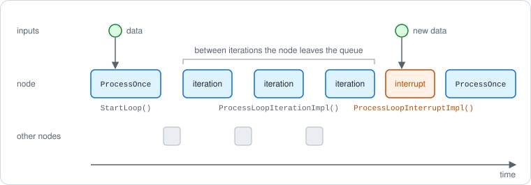
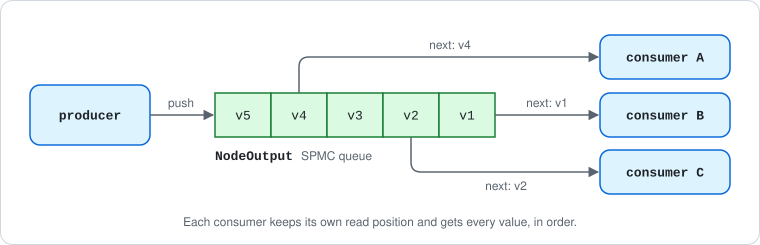
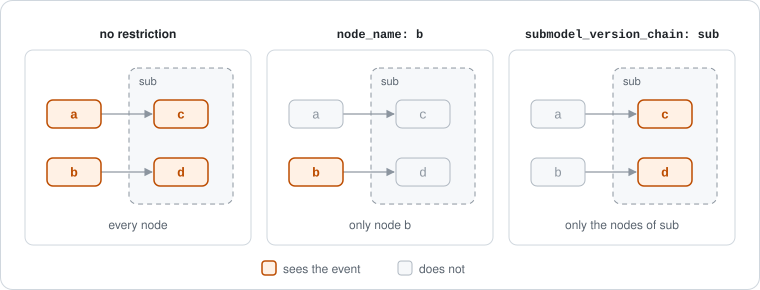

## Node

A **node** is the smallest unit of computation in a model. A node has **inputs**, **outputs** and **parameters**. Nodes are **reactive**: a node runs by itself as soon as all its inputs have values.



The same node in the config:

```yaml
- type: node
  name: node_name
  priority: 1
  inputs:
    input_1: data_1
    input_2: data_2
  outputs:
    output_1: data_3
    output_2: data_4
  params:
    params: param_v
```

### Optional input

An input can be marked as optional in the code of the node. Such an input may be left out of the config.

### Batch input / output

Inputs and outputs can be marked as batch. This works like a loop or a generator inside the graph.

A **batch output** lets one run of the node write one or more values. The nodes downstream process each value separately, so a batch output adds one level of data nesting. A node can only process inputs that are on the same nesting level.

A **batch input** collects all the values that came from the batch output upstream and removes one level of nesting.



### Dynamic input / output

Dynamic inputs and outputs are not fixed in the code of the node: the config defines them when the model is loaded.

### Recursive output

The computation graph must be acyclic. A recursive output adds something like a loop: it can be wired to an input of a node upstream, which receives the value on the next graph tick.

A recursive output is declared with `REGISTER_RECURSIVE_OUTPUT`. The first tick has no previous one, so the node overrides `DoInitRecursiveOutputs()` and pushes the initial value there; it is published when the model starts.



Limitations:

* All consumers of a recursive output must be in the same submodel version as the node that declares it. A recursive output cannot cross a [submodel](../runtime/README.md#submodel) boundary: it must not be listed in the `outputs` of its submodel or passed into the `inputs` of a nested one.
* The wiring of recursive outputs is not validated: a config that breaks the rule above, or the [input requirements](#input-requirements), is not rejected when the model is loaded.

### Loop

If a node does long computations that can be split into small subtasks, it can run a loop: between subtasks the node leaves the execution queue, so it does not hold a thread for long. When new data arrives, the loop is interrupted and the node decides whether to start it again. This makes the result depend on timing. To reproduce a run there is `loop_scheduler`: it records how many iterations ran between inputs and replays the same schedule later.

A node starts a loop with `StartLoop()` in `ProcessOnce()`; the iterations run in `ProcessLoopIterationImpl()` until the node calls `FinishLoop()`, and an interruption is handled in `ProcessLoopInterruptImpl()`.



### Priority

Nodes with a higher priority run first. Use it to balance the load inside the thread pool.

### Statistics

A node can collect statistics of its run time for profiling: see [Statistics](../runtime/README.md#statistics) of the runtime.

## NodeOutput

`NodeOutput` is the queue through which nodes exchange data: one producer, many consumers (SPMC). Every input and output of a node is such a queue. From the node's point of view all of them are typed.



## Event

An **event** is a message to the whole graph: every node is subscribed to events and decides which of them to handle. An event can name the nodes that must see it:

* `node_name` - id of the node that must see the event
* `submodel_version_chain` - path to the [submodel](../runtime/README.md#submodel) whose nodes must see the event



## Input requirements

* All non-optional inputs must be declared
* All inputs must have the same nesting level (see [Batch input / output](#batch-input--output))
* Input types must match the types the node expects
* There must be at least one non-recursive input

## Adding a new node
```cpp
class MyNode : public NodeBase {
 public:
  MyNode(const NodeBaseConfig& config)
      : NodeBase(config) {}

  void Reset() override {}

 protected:
  void ProcessOnce() override {
    const InputT& in = GetValue();
    OutputT out = DoSmth(in);
    PushResult(std::move(out));
  }

 private:
  REGISTER_INPUT(my_node,  value,  Value,  InputT,  "Input value")
  REGISTER_OUTPUT(my_node, result, Result, OutputT, "Result")
};

REGISTER_NODE(my_node, MyNode, "Node description for the catalog"); // variants of the macro also take params and a data_reader
```
