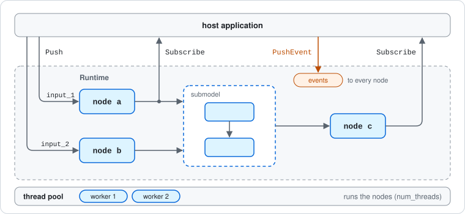
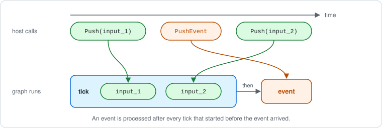
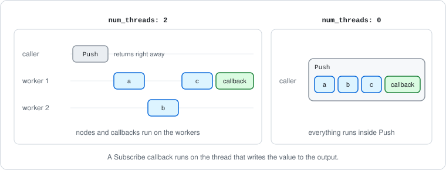
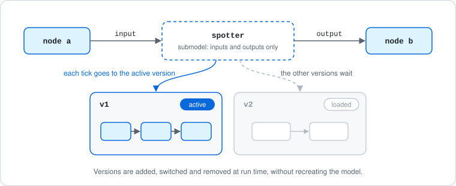
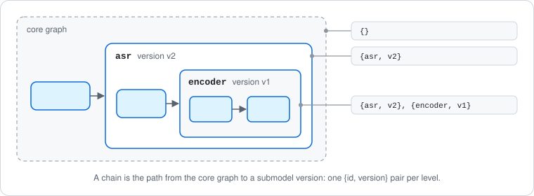
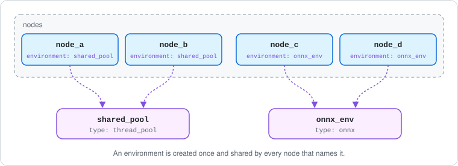
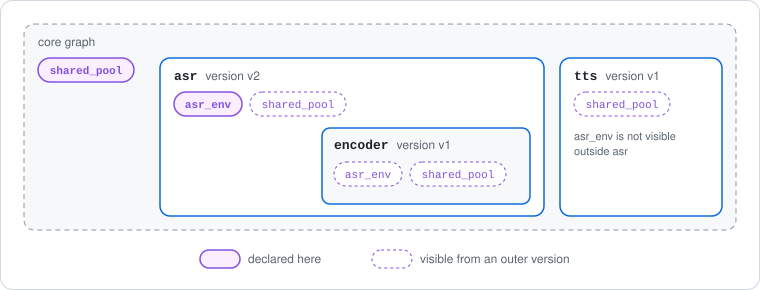

## Runtime

**Runtime** is the computation graph of a model: a set of connected [nodes](../node/README.md) and [submodels](#submodel). Nodes run in a [thread pool](#threadpool). Which calls may come from which thread is described in [Threads and exceptions](#threads-and-exceptions).

By default, the inputs of the model are the node and submodel inputs that no node produces. `SetInputs` replaces them with any others (see [Usage](#usage)).
You can subscribe to any output of any node in the graph.



The graph keeps data and events in a consistent order: an event is processed after every tick that had started before the event arrived, even if only a part of that tick's inputs was there. So `input_1, event, input_2` is processed the same way as `input_1, input_2, event`.



```yaml
version: model
lib_version: 1.0
num_threads: 2 # (see Threadpool)
load_threads: 1 # (see ../runtime_manager/README.md)
realtime_priority: true

common_node_params: # (see Statistics)
  statistics_length: 100
statistics_every_batches: 100

model_environments: # (see Environments)

nodes: # (see ../node/README.md)
  - ...

submodels:
  - ...

default_submodels: # (see ../runtime_manager/README.md)
  ...

features: # (see ../runtime_manager/README.md)
  - ...
```

## Usage
A runtime is created through the [runtime_manager](../runtime_manager/README.md).

```cpp
// Override the graph inputs, before the first Push: one Push into each of them makes one tick
model.SetInputs({"input_name", "another_input"});

// Subscribe to an output
auto sub = model.Subscribe<OutputT>(
  {}, "output_name",
  [](const OutputT& event, const std::any& external_data) {
    // ... handle the result
  }
);

// Push data
model.Push(submodel_version_chain, "input_name", data, external_data);

// Push an event, see ../node/README.md#event
model.PushEvent(Event{
  .node_name = "",
  .event = MyEvent{/* ... */},
  .submodel_version_chain = {},
});

// Wait until the model processes the data
while (!model.Empty()) {
  std::this_thread::sleep_for(std::chrono::milliseconds(10));
}

// Reset the model
model.Reset();

// Reset only the nodes of one submodel version
model.Reset(submodel_version_chain);

// Unsubscribe
model.Unsubscribe(sub);
```

`submodel_version_chain` in these calls is a [submodel version chain](#submodel-version-chain): it says in which
submodel version the input or output is looked up; `{}` is the core graph.

`SubscribeValueInfo` and `PushValueInfo` are the same calls with the full `ValueInfo` of the value (the tick `seq_id`,
the batch positions and `external_data`) instead of `external_data` alone. With `PushValueInfo` the caller sets the
`seq_id` itself.

## Threads and exceptions

* `Push`, `PushEvent`, `Subscribe` and `Unsubscribe` may be called from any thread, but concurrent `Push` calls to
  the same input must be serialized by the caller. Otherwise ticks may arrive out of order, and a node then skips
  the earlier one and loses its data.
* Version management (`AddSubmodelVersion`, `SetActiveSubmodelVersion`, `SetActiveSubmodelVersions`,
  `RemoveSubmodelVersion`) may be called from any thread too, and it does not stop the graph: `Push`, events and the
  nodes keep running meanwhile. Concurrent activations are applied one after another, and several versions can be
  loaded in parallel.
* `RemoveSubmodelVersion` returns when the nodes of the version are inactive and idle. For a version that is still
  active it waits until another version of the submodel is activated.
* A `Subscribe` callback runs synchronously on the thread that writes the value to the output: a thread pool worker
  for node outputs, or the caller's thread inside `Push` for graph inputs. With `num_threads: 0` there are no workers:
  nodes and callbacks run on the caller's thread inside `Push`, `PushEvent`, `Reset` and `SetActive*`.
* So a callback must be light: while it runs, its thread does not run nodes, and the rest of the graph waits for the
  worker (or, with `num_threads: 0`, the caller waits inside `Push`). Hand heavy work over to a thread of your own.
* A callback must not call `Unsubscribe`, `SetActiveSubmodelVersion(s)` or `RemoveSubmodelVersion`: they wait for the
  graph, which waits for the callback.
* The thread pool does not catch exceptions: an exception thrown by a node or a callback on a worker thread terminates
  the process. On the caller's thread (see above) it propagates out of the call that ran the node or the callback.



## Submodel

A submodel is an interface: a slot that is plugged into the graph as a single "node". Its entry in the config names the edges of the graph that go into it and come out of it:

```yaml
submodels:
  - id: spotter
    inputs:
      input: input
    outputs:
      output: output
```

## Submodel Version

A submodel version is an implementation of a submodel: a subgraph with its own nodes and submodels. A submodel can have any number of versions loaded at once, but each tick of the graph is processed by exactly one of them.



Versions are managed by the [runtime_manager](../runtime_manager/README.md): they are created, switched and removed while the model runs, without stopping or recreating it.

## Submodel version chain

`SubmodelVersionChain` addresses one submodel version in the graph. It is the path from the core graph down to that
version: a list of `{id, version}` pairs, one per nesting level. An empty chain is the core graph itself.

```cpp
// the core graph
SubmodelVersionChain core{};
// version v2 of the submodel asr
SubmodelVersionChain asr{.ids_chain = {{"asr", "v2"}}};
// version v1 of the submodel encoder inside asr v2
SubmodelVersionChain encoder{.ids_chain = {{"asr", "v2"}, {"encoder", "v1"}}};
```



The chain is used wherever a call has to name a place in the graph:

* `Push`, `Subscribe` and `HasOutput` look the input or output up among the edges of that version;
* `Reset(chain)` and `Event::submodel_version_chain` reach only the nodes of that version and of the submodels nested
  in it;
* `AddSubmodelVersion`, `SetActiveSubmodelVersion` and `RemoveSubmodelVersion` take the chain of the version to add,
  activate or remove.

## Threadpool

Graph nodes run in a shared thread pool. Its parameters are set at the top level of the config:

```yaml
num_threads: 2          # number of threads; 0 is the synchronous mode
realtime_priority: true # give realtime priority to all the threads
num_realtime_threads: 0 # ... or only to this many of them
thread_name_prefix: ge/ # name prefix for the worker threads
```

## Environments

An **environment** is a shared resource, for example a shared thread pool, an ONNX environment or a connection to an MCP service.

```yaml
model_environments:
  shared_pool:
    type: thread_pool
    thread_pool:
      threads_count: 2
      realtime_priority: false
      realtime_threads_count: 0
      thread_name_prefix: env
  onnx_env:
    type: onnx
    onnx:
      num_intra_threads: 1
      num_inter_threads: 1

nodes:
  - type: some_node
    name: ...
    params:
      environment: shared_pool
```



`model_environments` can be declared in the core config and in the config of any submodel version. An environment is
visible to the nodes of the version that declares it and of every submodel version nested in it, so the environments
of the core config are visible in the whole graph. A nested version that declares the same name replaces the
environment for itself and for the versions nested in it.



The types built into the runtime are `thread_pool` and `empty`; the others are registered by modules (`onnx`, `mcp`,
`web`), and a type whose module is not in the build is an error when the config is loaded.

## Statistics

Latency statistics are off by default and are turned on at the top level of the core config:

```yaml
common_node_params:
  statistics_length: 100      # how many last ticks to keep; 0 (the default) turns the statistics off
statistics_every_batches: 100 # print the table to stderr every N ticks; by default it is never printed
```

`GetStatistics()` returns run times in milliseconds: the mean, the 95th and 99th percentiles and the maximum. There
is one entry per node and an entry `runtime` for a whole tick, measured from `Push` until every subscriber has
received the result. On the returned object, `Print()` writes the table to stderr and `GetJson()` returns it as JSON.

## Dot

`WriteDot(path)` exports the graph to the Graphviz `.dot` format for visualization.
