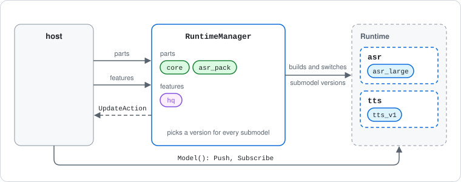
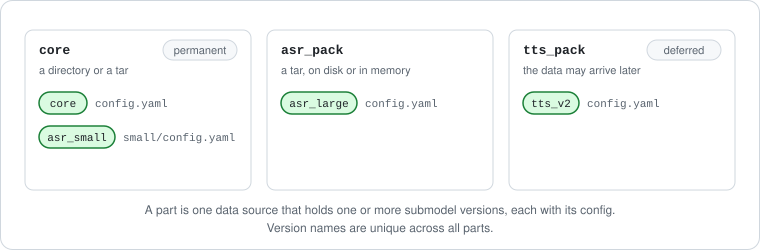
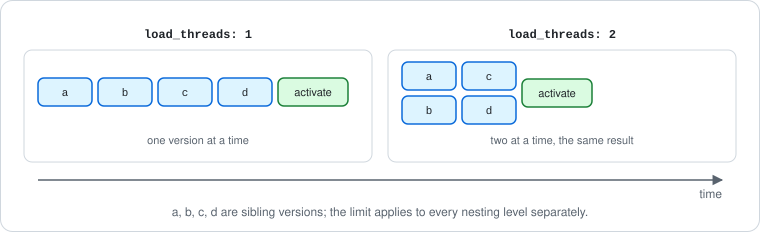
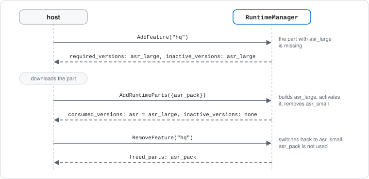
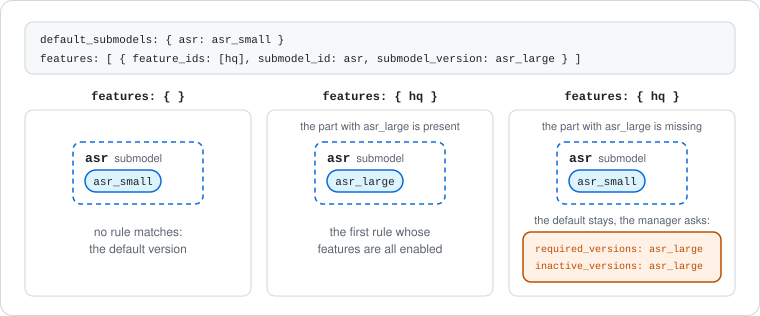
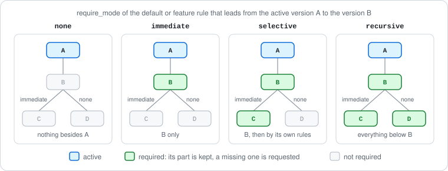

## RuntimeManager

**RuntimeManager** owns a [Runtime](../runtime/README.md) graph and decides what it consists of: it loads submodel versions from parts and switches them by features. It also holds capabilities: extensions that the host attaches to the model.



```cpp
// Create the manager
RuntimeManager manager(core_part, parts, environments, features);

// The model: push data into it, subscribe to its outputs
std::shared_ptr<Runtime> model = manager.Model();

// A separate graph built from a version of the current parts, with all the versions it depends on.
// It does not share environments with the model.
std::shared_ptr<Runtime> offline_model = manager.CreateRuntime("version_id");

// The state after the start: which parts are not needed, which versions are missing
UpdateAction action = manager.InitialUpdateState();

// Change the features and get the new state
action = manager.AddFeature("feature");

// Get a capability
auto capability = manager.GetCapability<MyCapability>();
```

## Threads

`RuntimeManager` is not thread-safe: the caller must serialize all calls. Capability hooks run synchronously on the
calling thread, inside the call that triggered them. The `Runtime` it manages has rules of its own: see
[Threads and exceptions](../runtime/README.md#threads-and-exceptions).

## RuntimePart

`RuntimePart` is a set of submodel versions that come from one data source. A part should be self-contained: every submodel in it has a default version declared, and that version is in the same part. The names of versions must be unique across all submodels.

```cpp
RuntimePart core{
  .id = "core",
  .data = ModelFileData{"path/to/core"}, // a directory or an archive
  .versions = {
    {CORE_VERSION_NAME, {.config_path = "config.yaml"}}, // the root graph
    {"asr_small", {.config_path = "small/config.yaml"}},
  },
};
RuntimePart asr_pack{
  .id = "asr_pack",
  .data = ModelFileData{"path/to/asr_pack.tar"},
  .versions = {{"asr_large", {.config_path = "config.yaml"}}},
};

RuntimeManager manager(core, {asr_pack}, /*environments=*/{}, /*features=*/{"hq"});
```

* `id` - the name of the part. The manager reports it in `freed_parts`, and `RemoveRuntimeParts`, `HasPart` and
  `IsPartReady` take it;
* `data` - where the files of the part are: `ModelFileData` is a path to a directory or an archive,
  `ModelPersistentTarData` is a tar buffer in memory that the host keeps alive, `ModelTemporaryTarData` is a callback
  that returns such a buffer when the manager needs it;
* `versions` - the versions in the part: the name of each version and the path of its config inside the part. These
  names are what `default_submodels` and `features` refer to (see [Version selection](#version-selection)). The first
  argument of the constructor is the part with the root graph: its version must be named `core`
  (`CORE_VERSION_NAME`);
* `permanent` - the manager never releases the part as unused (for example, a model shipped with the firmware). The
  part with the root graph is never released anyway;
* `deferred` - the data of the part may appear later, see [UpdateAction](#updateaction).

Parts are added and removed with `AddRuntimeParts(parts)` and `RemoveRuntimeParts(part_ids)`. What can be asked about
them:

* `GetPartIds()` - the declared parts;
* `HasPart(id)` - whether a part is declared;
* `IsPartReady(id)` - whether a part is declared and its data can be read (for a deferred part: the configs of all its
  versions);
* `GetVersionPart(version)` - the part that holds a version;
* `GetDataReader(id)` - the reader of the data of a part, the same one the manager reads the configs with. Use it to
  read other files of the part, for example the data of your capability.




## Parallel loading

`load_threads` at the top level of the core config sets how many submodel versions of one nesting level are built at
the same time. The default is 1: one at a time.

The result does not depend on the value:

* if a version fails to build, its sibling versions that come after it in the traversal order are not used and do not
  get into `inactive_versions`. The order in which submodels are traversed is unspecified and has nothing to do with
  their order in the config;
* an exception from any branch reaches the caller, and the versions that were built next to the failed one are
  removed.

Two things to keep in mind with `load_threads` above 1:

* nodes that share a resource must create it in a thread-safe way, for example ORT sessions with an `onnx`
  environment declared in the core;
* the limit applies to each nesting level separately, so up to N^depth versions are built at once. Mind the peak
  memory.



## Features
Features are switches by which the manager chooses which version of which submodel to use. `FeatureManager`
(`GetFeatureManager()`) keeps them in separate sets, one per source (`FeatureSetType`):

* `CLIENT` - the features of the host, changed with `SetFeatures`, `AddFeature`, `RemoveFeature` and `SetState`.
  `Features()` returns the current set;
* `CAPABILITY` - the features that capabilities turn on through `RuntimeCapabilityBase::AddFeature` / `RemoveFeature`.
  The host neither sees nor overwrites them.

The graph is built from the union of the sets. A feature cannot be in two sets at once: adding it to the second one
throws an exception.


## UpdateAction

Every method that changes the state returns an `UpdateAction`: what the manager did and what it expects from the
host.

* `freed_parts` - the parts the manager no longer needs and has released;
* `required_versions` - the versions the manager lacks and asks the host to load. Until then the default version of
  the submodel works in their place;
* `inactive_versions` - the versions that the current features require but that are not active after the update:
  their part is missing (see `required_versions`), or the version failed to come up and the manager kept the previous
  one. An empty list means the requested features were applied in full, so the host does not have to check
  `consumed_versions` itself;
* `consumed_versions` - the version that is active now in each submodel slot;
* `available_features` - the features that can be turned on or off in the graph as it is now.

A downloaded version that fails to build is not requested again: otherwise the host would hand over the same part in
a loop. Its part is kept while the version is required, and the version shows up in `inactive_versions` but not in
`required_versions`.

A part with `deferred = true` can be declared before its data is on disk, for example before it is downloaded. If the
config of one of its versions cannot be read yet, the manager does not treat it as an error: it puts the version into
`required_versions` and leaves it alone until features ask for it. The data is picked up on the next `SetFeatures`;
the part does not have to be registered again. The manager never releases such a part as unused: it can only be
removed with `RemoveRuntimeParts`. Without the flag, a declared part that cannot be read fails the update with an
exception.




## Capabilities

Capabilities are typed extensions: the host attaches them to the manager and gets them back by type. Each capability derives from `RuntimeCapabilityBase`:

```cpp
manager.RegisterCapability<MyCapability>(cap);
if (manager.HasCapability<MyCapability>()) {
  std::shared_ptr<MyCapability> cap = manager.GetCapability<MyCapability>();
}
```

The manager calls lifecycle hooks on all registered capabilities:
* `OnBeforePartsRemoved()` - before parts are removed, whether by `RemoveRuntimeParts` or because they are no longer
  used. The hook must not change parts or features: right after it the manager removes the parts it has already
  listed.
* `OnAfterStateUpdated()` - after every successful update of the state. The hook may change the state of the manager,
  for example add a feature. That starts a nested update, so the hooks must not call each other without end.

## Version selection
Which version of a submodel is active is decided by the config of the version that contains the submodel:

* `features` - rules that are checked in the order they are written: the first rule whose `feature_ids` are all
  enabled gives the version. A rule with an empty `feature_ids` always matches, so the rules below it are never
  reached;
* `default_submodels` - the version of a submodel when no rule matches. It is also the version the manager keeps
  active while the part of the chosen version is missing (the chosen version is then reported in
  `required_versions`). So the default version must always be at hand: keep it in the same part as the submodel.

```yaml
default_submodels:
  submodel: default_version
  other_submodel: # the same with a require_mode
    submodel_version: other_default_version
    require_mode: immediate

features:
  - feature_ids: [some_feature]
    submodel_id: submodel
    submodel_version: version_for_feature
    require_mode: none

  - feature_ids: []
    submodel_id: submodel
    submodel_version: version_no_features
    require_mode: none
```



### require_mode
A **required** version is one the manager keeps at hand even when it is not active: the part that holds it is not
released as unused, and when no part holds it, the version is reported in `required_versions`. The `require_mode` of
a `features` rule or of a `default_submodels` entry says how far this reaches, starting from the active versions:
* none (the default) - the version is required only if it is selected by features
* immediate - the version is always required, but the versions inside it are not
* selective - the version is always required, the versions inside it according to their own require_mode
* recursive - the version is always required, and the versions inside it are always required too, regardless of their require_mode



`CollectSubmodelsMeta(roots, root_require_mode)` walks the versions in the same way, starting from the ones you give
it. `roots` are [version chains](../runtime/README.md#submodel-version-chain) (an empty chain is the root graph), and
each of them is expanded with `root_require_mode` (`recursive` by default). The result lists the `version_id` of every
version reached and the `version` field of its config (`config_version`, empty when no part holds the version). It is
`std::nullopt` when a config cannot be read.

`GetMissingSubmodelVersions` tells in advance what would have to be loaded, and changes nothing. It takes version
names (each is expanded as `selective`) or version chains (the last version of a chain is expanded with the
`require_mode` of the rule that leads to it). It returns the reached versions that no part holds.
