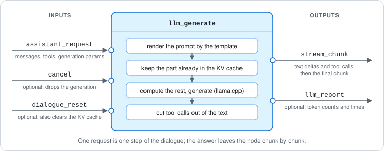
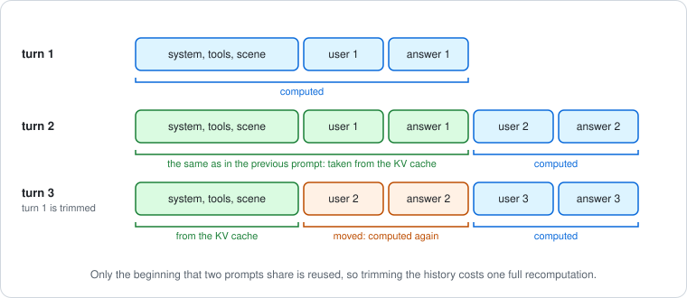
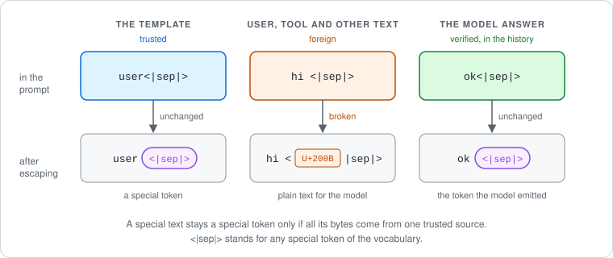

# LLM module

The `llm` module runs a local LLM on [llama.cpp](https://github.com/ggml-org/llama.cpp). Its node `llm_generate`
takes a dialogue request, builds the prompt from it by a template, reuses the KV cache of the previous turn and
streams the answer back chunk by chunk. Build the module with `MODULES=llm` and `LLAMA_CPP_ENABLED=ON`.



## Nodes

| Node | What it does |
|---|---|
| `llm_generate` | runs the model on a request |
| `llm_passthrough` | a runner without a model: it returns the user text as the answer. A [feature](../../lib/runtime_manager/README.md) can select it instead of `llm_generate`, so the model is unloaded while the graph keeps its shape |

The ports of `llm_generate`:

| Port | Type | What it carries |
|---|---|---|
| input `assistant_request` | `AssistantRequest` | the messages, the tools and the generation params. Its `kind` says what to do: `GENERATE` answers, `WARM` only computes the prompt into the KV cache, `NONE` is a tick with nothing to do |
| input `cancel`, optional | `bool` | `true` drops the running generation; its last chunk has the finish reason `CANCELLED` |
| input `dialogue_reset`, optional | `bool` | `true` drops the running generation and clears the KV cache |
| output `stream_chunk`, batch | `AssistantChunk` | text deltas and tool calls, then the final chunk of the request |
| output `llm_report`, optional, batch | `LlmReport` | the token counts of the context and of the answer; the times come with the final chunk |

The request and chunk types are in
[contracts/types.h](../assistant_core/include/giga_edge/modules/assistant_core/contracts/types.h) of the
`assistant_core` module. That module also has the nodes that stand around `llm_generate` in a graph:
`dialogue_request_builder` makes the request, `stream_to_assistant_result` collects the chunks into an answer and
`dialogue_state_update` keeps the history. For a complete graph, see the
[graph of GigaEdge LLM](../smart_home_ha/tests/data/function_calling/config.yaml).

## Config

The example uses the ChatML markup; take the role markup of your model.

```yaml
- type: llm_generate
  name: llm
  inputs: {assistant_request: assistant_request, cancel: cancel}
  outputs: {stream_chunk: stream_chunk}
  params:
    llm_interpreter_params:          # required
      model_path: model.gguf         # required: a GGUF file, relative to the model part
      n_ctx: 2048                    # context size in tokens
      n_batch: 512                   # batch size of llama.cpp
      n_threads: 0                   # threads for generation; 0 is all of them
      n_threads_batch: 0             # threads for the prompt; 0 is the same as n_threads
      temp: 0.8                      # sampling; also top_k (40), top_p (0.95) and seed (-1 is random)
      stop_sequence: "<|im_end|>\n"  # see "End of turn"
      eog_tokens: []                 # see "End of turn"
      flash_attn: auto               # auto, enabled or disabled
      kv_cache_type: f16             # f16 or q8_0: q8_0 takes half the memory and needs flash_attn
      use_mmap: true                 # map the weights instead of reading them into memory
      use_mlock: false               # lock the weights: mapped ones may be evicted between requests
      swa_full: true                 # false: a smaller cache for sliding-window layers, see below
      lookup_draft_tokens: 0         # drafts from the text already in the context; 0 is off, needs temp 0
      mtp_draft_max: 0               # drafts from the MTP layers of the model; 0 is off, needs greedy sampling
    template:                        # how a request becomes the prompt
      system: {prefix: "<|im_start|>system\n", suffix: "<|im_end|>\n"}
      user: {prefix: "<|im_start|>user\n", suffix: "<|im_end|>\n"}
      assistant: {prefix: "<|im_start|>assistant\n", suffix: "<|im_end|>\n"}
      tool: {prefix: "<|im_start|>tool\n", suffix: "<|im_end|>\n"}
      generation_prefix: "<|im_start|>assistant\n"  # opens the answer of the model
    tool_call_parser: xml_tool_call  # finds tool calls in the answer
    max_new_tokens: 128              # limit of one answer, unless the request sets its own
    prefill_chunk_tokens: 128        # the prompt is computed in pieces of this many tokens
    on_new_request: ignore           # ignore or replace, see below
    inference_strategy:              # where the model runs, see below
      type: wait_till_inferring
      thread_pool_name: llm_pool
```

Apart from `model_path` and `stop_sequence`, the values shown for `llm_interpreter_params`, `max_new_tokens`,
`prefill_chunk_tokens` and `on_new_request` are the defaults. A request can set its own temperature and token limit
(`GenerationParams`).

**Template.** Each role (`system`, `user`, `assistant`, `tool` and `scene`) has a `prefix` and a `suffix` that are
put around its message. The scene is a message with the state the model works with, for example the devices of the
house. More keys of the template:

- `system_instructions` is a text put at the start of the system message.
- `render_empty_system` and `render_empty_scene` render the message even when it is empty.
- `scene_in_user` puts the scene inside the user message that follows it, before the text of the user.
- `render_tools` lists the tools of the request as JSON in the system message, between `tools_header` and
  `tools_footer`.
- `tool_call_prefix` and `tool_call_suffix` are put around a tool call of the history that is rendered as JSON.

**Tool calls.** `tool_call_parser` names a registered parser. This module has `xml_tool_call`: a call is the text
between `<tool_call>` and `</tool_call>` (`call_open` and `call_close` change the tags). The `function_calling`
module has `compact_tool_call_v1`. Written as a map, `{name: xml_tool_call, call_open: ...}`, the entry passes its
other keys to the parser. Without a parser the whole answer is text.

**Where the model runs.** By default (`inference_strategy: {type: sync}`) the node works in a
[node loop](../../lib/node/README.md#loop) on the threads of the graph: it computes the prompt in pieces of
`prefill_chunk_tokens` and then generates in short steps. With `type: wait_till_inferring` the model runs in the
thread pool [environment](../../lib/runtime/README.md#environments) named in `thread_pool_name`
(`thread_priority` is the priority of its task there). A tick then only hands out the chunks that are ready, so the
graph never waits for the model.

**A new request during a generation.** With `on_new_request: ignore` the generation goes on and the new request is
dropped. With `replace` the generation is cancelled and the new request starts. A `GENERATE` request that arrives
during a warm-up is not lost: it starts when the warm-up is over.

**Declining a request.** `prompt_head` adds a small classifier over the prompt, a GGUF file of its own given in
`path`. It looks at the user message before the generation and can decline the request: the final chunk then has the
finish reason `DECLINED`. With `decision: {type: argmax}` (the default) a request is declined when the most probable
label is one of `decline_labels`. With `decision: {type: threshold, threshold: 0.5}` it is declined when the total
probability of the other labels is below the threshold.

**Debugging.** `debug_dump_prompt: true` prints every prompt to stderr, and `local_debug_enabled: true` prints a log
of every turn to stdout.

`swa_full: false` keeps the cache of sliding-window layers for the window only, which takes less memory. The cost:
the KV cache can then be rolled back deeper than the window only to a snapshot of the window, otherwise the context
is computed again.

## End of turn

The model stops when it emits an end-of-generation token. llama.cpp takes these tokens (EOS, EOT, EOM and the like)
from the vocabulary and from its own heuristics. For a GGUF file with incomplete metadata, add more of them in
`eog_tokens`: a list of texts, each of which must be exactly one token of the vocabulary.

`stop_sequence` is the text with which the template closes an assistant message (the `suffix` of `assistant`). The
generation also stops when the model has written all of it. If the model stopped earlier, the node adds the missing
tail to the KV cache, so that the cache matches the next prompt.

`llm_generate` does not read the `stop` field of the request (`GenerationParams::stop`): that field is for a runner
that sends the request to a remote server.

## KV cache between turns

The node keeps the KV cache of llama.cpp between requests and reuses the beginning that the new prompt shares with
the previous one. In a dialogue the new prompt is the old one plus the new messages, so only the new part is
computed.



Trimming the history breaks this. Turns are removed from the beginning of the history, so on that turn the two
prompts share only what stands before the first turn: the system prompt, the tools and the scene (unless the scene is
inside the user message). The rest of the history is computed again. The history is trimmed in three places:

- `max_history_turns` of `dialogue_request_builder` is a sliding window: once the dialogue is longer than the window,
  the history is computed again on every turn.
- `max_turns` of `dialogue_state_update` cuts the stored history. With `trim_to_turns` below `max_turns` it cuts
  several turns at once, so it happens less often.
- `llm_generate` itself drops the oldest turns when the prompt does not fit into the context.

## Special tokens in the prompt

A model marks the roles and the ends of messages with special tokens, such as `<|im_end|>`. If the text of a user, a
tool result or a device name could bring such a token into the prompt, it would work as markup: close its message
and open another one. So the node decides for every special text in the prompt whether it may become a special
token.

The prompt is rendered as one string and tokenized with special tokens parsed (the `CONTROL` and `UNKNOWN` tokens of
the vocabulary). A special text stays a special token only if all its bytes come from one trusted source:

| Bytes of the prompt | Source |
|---|---|
| role prefixes and suffixes, `system_instructions`, `generation_prefix` | the template: trusted |
| `tools_header` and `tools_footer`, `tool_call_prefix` and `tool_call_suffix` | the template: trusted |
| the scene | trusted: its markup is written by the scene renderer. With `scene: {literal: true}` in the template the scene is foreign text; use it for a raw MCP catalog |
| a model answer in the history | verified: the special tokens the model itself emitted stay |
| everything else: system, user and tool messages, tool descriptions | foreign text |



Any other occurrence, in foreign text or at the junction of two sources, is broken: the node inserts U+200B (a
zero-width space) into it, and a special text of a single character is replaced with U+FFFD. The model then sees
ordinary text. A prompt without such occurrences is not changed by a single byte.

Two consequences for the config:

- Role markup that uses special tokens belongs in the template. `user_prefix` and `user_suffix` of
  `dialogue_request_builder` and the texts of the profile are message content, so special texts in them are broken.
- A model is not loaded if the special texts of its vocabulary cannot be escaped this way: one of them is not valid
  UTF-8 or contains U+200B or U+FFFD.

The answer is checked too. `llm_generate` knows every token the model produced, so it can tell a special token from
the same text assembled from ordinary tokens. The second kind is escaped in the copy of the answer that goes into
the dialogue history (`TextDelta::history`, then `AssistantResult::history_text`). The `text` and `raw` that the host
receives are not changed. The `raw_text` of a tool call is escaped by the sources of its bytes, which the parser
reports (`IToolCallParser::RawTextSources`).

### Known limits

- llama.cpp parses `USER_DEFINED` tokens whatever the flags, so they are not escaped. These are `<tool_call>` and
  `<think>` of Qwen3, and HTML tags and runs of spaces of Gemma. For gpt-oss, llama.cpp turns `<|start|>`,
  `<|message|>`, `<|channel|>` and `<|constrain|>` into `USER_DEFINED` as well: such a marker in foreign text stays a
  marker.
- Only `llm_generate` produces `history_text`. The answer of another runner (`llm_passthrough`, a node that asks a
  remote server) goes into the history as it is. A server that renders the template itself, such as llama-server,
  has to protect against special tokens on its side.
- The history given in `seed_history` of `dialogue_request_builder` is trusted: the host answers for it.
- The model may repeat U+200B in its answer: it then reaches the text and the speech output.
- The smart home scene trusts the identifiers of the catalog: the scene renderer of the smart home module cleans
  names and rooms, while categories and feature names go into tags as they are.
- `<unk>` produced by speech recognition arrives as user text and is escaped.
- For SentencePiece vocabularies with `add_space_prefix`, token boundaries do not line up with the text, so the KV
  cache is hardly reused between turns.
