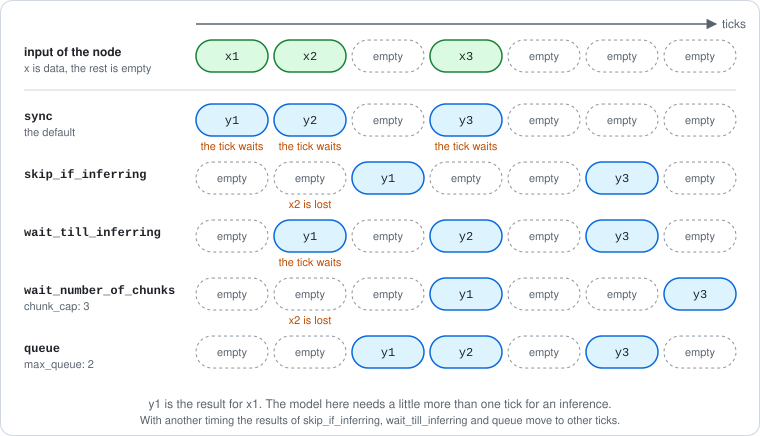

# Inference strategies

The `model` node ([ModelNode](../../../../internal/giga_edge/modules/model/nodes/model/model.h)) runs a model
([Model](../../../../internal/giga_edge/modules/model/models/model.h)) on its inputs. An inference strategy decides
how: whether the tick waits for the model or the model runs in a thread pool, what happens to an input that comes
while the model is busy, and on which tick a result comes out.

An input is *empty* when the vectors on the inputs of the node are empty, and it is *data* otherwise; a tick where
some are empty and some are not is an error. The node gives an output on every tick: a result, or empty vectors when
it has nothing to give.



## Strategies

| `type` | The model runs | A result comes out | Data that comes while the model is busy |
|---|---|---|---|
| `sync`, the default | inside the tick | in the same tick | does not happen: the tick waits |
| `skip_if_inferring` | in a thread pool | on the first tick after the inference has finished | is dropped |
| `wait_till_inferring` | in a thread pool | on an empty tick when it is ready, or on the next data, which waits for it | waits for the model |
| `wait_number_of_chunks` | in a thread pool | exactly `chunk_cap` inputs after the one that started it | is dropped |
| `queue` | in a thread pool, one input after another | one per tick, the oldest first | is put into the queue |

- **`sync`** runs the model and pushes the result in one tick. The results are the same from run to run.
- **`skip_if_inferring`** never makes a tick wait. While the model is busy, every input is ignored, so which data is
  dropped depends on how long an inference takes: the results differ from run to run.
- **`wait_till_inferring`** loses nothing. When data comes while the model is busy, the tick waits for the inference
  in flight, pushes its result and starts the model on the new data. So the result for an input comes out with the
  next data or on an empty tick, whichever is first. The results are the same from run to run; only the tick they
  come out on may differ.
- **`wait_number_of_chunks`** counts inputs. After it starts the model, it gives empty outputs for the next
  `chunk_cap - 1` inputs and drops data among them with a warning. On input number `chunk_cap` it waits for the model
  if it is still busy and pushes the result; if this input is data, the model starts on it. Choose `chunk_cap` so
  that data is not dropped. The inputs that are dropped are picked by counting, not by timing, so the results are
  the same from run to run.
- **`queue`** puts data into a queue that a single task computes strictly in order, so the tick does not wait and
  nothing is lost. Each tick gets the oldest ready result or an empty output. When `max_queue` inputs are in work,
  new data waits for the oldest one, whose result then comes out on this tick; with `max_queue: 1` it is the same as
  `wait_till_inferring`. The results are the same as with `wait_till_inferring`: the same inputs, order and model
  state. Give the queue a thread pool of its own: its task holds a pool thread while the queue is not empty. Shape
  inputs (`shape_inputs`) are not supported.

## Getting the last result: `force_wait`

With `wait_till_inferring` and `queue` the result for the last data comes out on a later tick, once it is ready. The
optional input `force_wait` of the node makes a tick wait for it instead; the other strategies ignore it.

- **`wait_till_inferring`**: an input with `force_wait` waits for the inference in flight. If the node was busy,
  this input itself is computed in the pool and comes out with the next one. So follow the data with one empty input
  with `force_wait`: this is `flush_tail` of the `feature_iterator_with_reset` node.
- **`queue`**: an input with `force_wait` waits for the whole queue. The results still come out one per input, so
  follow the data with `max_queue` such inputs: `flush_tail_count` of `feature_iterator_with_reset`. If results are
  left in the node after them, it prints a warning.

## Config

The strategy is a part of the params of the `model` node:

```yaml
model_environments:
  model_pool:
    type: thread_pool
    thread_pool: {threads_count: 1}

nodes:
  - type: model
    name: model
    # ...
    params:
      # ...
      inference_strategy:
        type: wait_number_of_chunks
        thread_pool_name: model_pool
        chunk_cap: 3
```

| Key | Strategies | What it is |
|---|---|---|
| `type` | all | `sync`, `skip_if_inferring`, `wait_till_inferring`, `wait_number_of_chunks` or `queue`. Without `inference_strategy` or without its `type` the strategy is `sync` |
| `thread_pool_name` | all but `sync` | required: the name of a `thread_pool` [environment](../../../../../../lib/runtime/README.md#environments) where the model runs |
| `thread_priority` | all but `sync` | the priority of the task in that pool, 0 by default |
| `chunk_cap` | `wait_number_of_chunks` | 1 by default. A value below 1 becomes 1, with a warning |
| `max_queue` | `queue` | 1 by default. A value below 1 is an error |

For more configs, see the [tests](../../../../tests/src/nodes/inference_strategies.cpp).

## Adding a strategy

A strategy is a state machine behind
[IInferenceStrategy](../../../../internal/giga_edge/modules/model/nodes/model/inference_strategies/inference_strategy.h).
In every tick the node asks it for the next action with `NextAction()`, does the action, and tells the strategy what
happened, until the strategy answers `FINISH_PROCESSING`.

What the node tells the strategy:

| Call | When |
|---|---|
| `OnInputs` | the node has read an input with data |
| `OnEmptyInputs` | the node has read an empty input |
| `OnForceWait` | the tick came with `force_wait`; by default it does nothing |
| `OnInferred` | an inference has finished |
| `OnPushedOutputs` | the node has pushed its outputs |
| `OnReset` | the node is reset |

What the strategy may ask for (`InferenceStrategyAction`):

| Action | What the node does |
|---|---|
| `READ_INPUTS` | reads the inputs |
| `SYNC_INFERENCE` | runs the model in the tick |
| `ASYNC_INFERENCE` | starts the model in the thread pool |
| `CHECK_INFERENCE` | checks whether that inference has finished |
| `WAIT_INFERENCE` | waits in the tick until it has finished |
| `PUSH_OUTPUTS` | pushes the results of the model |
| `PUSH_EMPTY_OUTPUTS` | pushes empty outputs |
| `ENQUEUE_INFERENCE` | puts the data into the queue of the pool |
| `WAIT_QUEUE` | waits for the whole queue |
| `PUSH_QUEUED_OUTPUTS` | pushes the oldest ready result of the queue, or empty outputs |
| `FINISH_PROCESSING` | ends the tick |
