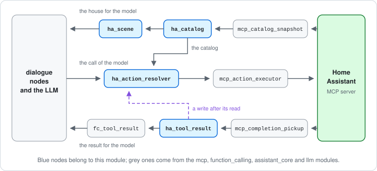
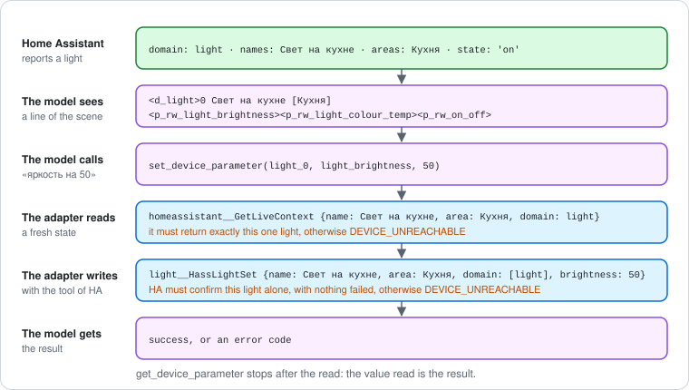

# Home Assistant adapter

The `smart_home_ha` module is an adapter for GigaEdge LLM, the smart home function-calling model that comes with
the [offline assistant demo](../../../example/offline_assistant/README.md#2-models) as its part `function_calling`.
It connects this model to a Home Assistant through its built-in MCP server (`/api/mcp/assist`). It shows the house
to the model in the compact catalog format the model was trained on (`d_*` devices, `p_rw_*` and `p_ro_*`
parameters, the functions set, get, relative and copy), so the model needs no retraining. It then turns the calls
of the model into Home Assistant tools.

The device categories, the parameters and the functions described here are those of this model. Another LLM works
with the adapter only if it speaks the same format.

- It needs Home Assistant 2026.9 or newer, where the tools have the prefixes `intent__` and `homeassistant__`.
  Reads and writes are verified against 2026.10.1 and 2026.11.2.
- It sees only the entities exposed to Assist: the exposure settings of Home Assistant decide what can appear.
- It does not depend on other smart home adapters and has no LLM or MCP loop of its own: it works between the
  existing nodes of a graph.



## Nodes

| Node | What it does |
|---|---|
| `ha_catalog` | reads the house from the resource `homeassistant://assist/context-snapshot` (with the text/YAML envelope of Home Assistant) and builds a catalog of the devices; reads it again from time to time |
| `ha_scene` | renders the catalog as the scene for the model |
| `ha_action_resolver` | turns the final call of the model, or the continuation of an earlier one, into an MCP action. Wire its `dialogue_reset` to the signal that combines reset and cancel in your graph |
| `ha_tool_result` | turns the replies of Home Assistant into compact results for the model, or into the next read or write |

Around them a graph uses the existing nodes: `mcp_catalog_snapshot`, `mcp_action_executor`, `mcp_completion_pickup`,
`fc_tool_result`, the dialogue nodes and the LLM. For a complete graph, see the
[graph of GigaEdge LLM](tests/data/function_calling/config.yaml).

## What the assistant can do

| Home Assistant | The model sees | Parameters |
|---|---|---|
| `light` | `light` | `on_off`, `light_brightness`, `light_colour`, `light_colour_temp` (both write-only with Home Assistant) |
| `vacuum` | `vacuum_cleaner` | `on_off`, `vacuum_cleaner_status` |
| `switch` | `socket` | `on_off` |
| `climate` | `hvac_heater` | `on_off`, `hvac_temp_set`; read-only: `temperature`, `hvac_humidity_set` |
| `fan` | `hvac_fan` | `on_off`, `hvac_air_flow_power` (if Home Assistant reports `percentage`) |
| `humidifier` | `hvac_humidifier` | `on_off`, `hvac_humidity_set` |
| `cover` | `curtain`, `window_blind` or `gate` | `open_set`, `open_percentage` |
| `valve` | `valve` | `open_set`, `open_percentage` |
| `media_player` with the device class `tv` | `tv` | `on_off`, `volume_int`, `mute` (write-only) |
| `sensor` with the device class `temperature` or `humidity` | `sensor_temp` | read-only: `temperature` or `humidity` |
| `binary_sensor` | `sensor_door`, `sensor_pir`, `sensor_smoke`, `sensor_gas`, `sensor_water_leak` | read-only, see below |
| `scene`, `script` | `socket` | `on_off` (write-only), see [Scenes and scripts](#scenes-and-scripts) |

The categories are limited to the vocabulary of the model, which explains some of the names:

- **Lights.** For a dimmable light that is off Home Assistant reports an empty brightness. The adapter reports 0, so
  a relative step («ярче») starts from it and turns the light on.
- **Vacuums.** `on_off` starts cleaning or requests a return to base. The state maps `cleaning`, `docked`,
  `paused`, `returning` to the model's `cleaning`, `docked`, `pause`, `returning_to_dock`. An idle vacuum is not
  cleaning, but has no model status; unknown and error states have no fabricated values. Writing status supports
  `cleaning`, `docked` and `returning_to_dock`; pause has no mapped intent. Both vacuum tools must exist for writing.
  The live context omits battery level: charge, programs, cleaning type and child lock are not offered.
- **Capabilities.** Assist reports neither per-entity vacuum features nor colour modes. HA rejects unsupported
  vacuum actions, but may accept a colour request for a white-only lamp without changing its colour.
- **Climate** is always `hvac_heater`: the live context has no `hvac_modes` and does not say what a climate heats.
  A climate is on in every hvac mode but `off`. The `humidity` of a climate or a humidifier in Home Assistant is the
  target humidity, so it is `hvac_humidity_set`; the measured `current_humidity` is not in the context. Only a
  humidifier can set it: Home Assistant has no intent for the humidity of a climate. Setting it turns a humidifier
  that is off on, as `HassHumidifierSetpoint` does. The context does not report the range of the humidifier, so a
  value out of it is refused by Home Assistant and comes back as `DEVICE_UNREACHABLE`.
- **Fans.** Home Assistant sets a fan by percentage, the model by a named speed of `hvac_air_flow_power`: quiet, low,
  medium, high, turbo, slowest first. A percentage is read as Home Assistant reads an ordered list of speeds
  (`percentage_to_ordered_list_item`): 1..20 is quiet, 21..40 low and so on, 0 has no speed. A speed is written as
  the lowest percentage of its band: 1, 21, 41, 61, 81. A fan rounds it up to a speed of its own (`math.ceil` in the
  fan docs of Home Assistant), so a fan of 5 speeds or more reads back the speed that was set; with 3 or 4 speeds
  neighbouring names share a speed. A relative change steps one speed up or down. `auto` is a preset mode in Home
  Assistant, which MCP cannot set. `fan__HassFanSetSpeed` is `fan.turn_on` with a percentage: a fan without the turn
  on feature refuses it, and the live context does not tell which fans have it.
- **Covers** are `window_blind` for the device classes blind, shade, shutter and awning, `gate` for gate, garage and
  door, and `curtain` otherwise. A cover or a valve gets `open_percentage` only if Home Assistant reports its
  `current_position`.
- **TVs.** Only media players with the device class `tv` appear. The context does not list supported features, so
  volume and mute are offered on every TV, and a TV without them answers such a write with an error.
- **Sensors.** A temperature or humidity sensor is `sensor_temp`. Binary sensors are `true` when on: door and
  garage door are `sensor_door` (`doorcontact_state`), motion is `sensor_pir` (`pir`), smoke is `sensor_smoke`
  (`smoke_state`), gas is `sensor_gas` (`gas_leak_state`), moisture is `sensor_water_leak` (`water_leak_state`).
  Other classes and sensors that report only a battery level are not shown.
- **Write-only parameters.** The live context of Home Assistant reports neither the colour, nor its temperature or
  modes, nor the mute state. So `light_colour`, `light_colour_temp` and `mute` have no current value and are offered
  on every light and TV whose tool exists. An absolute value works. Reading, copying or a warmer or colder step
  («теплее», «холоднее») answers `UNKNOWN_PARAMETER`; a relative step of colour or mute answers
  `RELATIVE_NOT_ALLOWED`.
- **Colour from other servers.** A server that reports `rgb_color` (three integers) or `color_temp_kelvin` for a light
  makes its colour or colour temperature readable: the colour becomes `R;G;B`, the kelvins become the percent of the
  same 2700..6500 K scale as the write. Then they can be read, copied and made warmer or colder; as the model expects,
  a step up («+», «теплее») is warmer, that is a smaller percent. A read colour reaches the model as the nearest of
  thirteen basic Russian colour words («красный», «голубой», «сиреневый»…), each with the RGB the model writes for it,
  so the model says a word and not the triplet; a copy keeps the triplet. The virtual house of the demo reports them.
- Values that Home Assistant reports as unknown or unavailable stay unknown.
- **Availability.** With `include_online` of `ha_catalog` (false by default) every device that comes from the
  context gets the read-only parameter `online`, the way the model saw it in training: in the scene it is sorted
  among the other parameters by its name without the access prefix (`<p_rw_on_off><p_ro_online>`). It can be read
  even when the device is unavailable, and a set, a relative change or a copy into it answers
  `PARAMETER_READ_ONLY`. A script is not in the context and has nothing to read, so it has no `online`; a device
  is not shown for `online` alone.

How a parameter is read and written:

| Parameter of the model | Home Assistant tool |
|---|---|
| `on_off` of a light, socket, climate, fan, humidifier or TV | `intent__HassTurnOn` / `intent__HassTurnOff` |
| `on_off` of a vacuum | `vacuum__HassVacuumStart` / `vacuum__HassVacuumReturnToBase` |
| `vacuum_cleaner_status` | the same vacuum tools: `cleaning` starts, `docked` or `returning_to_dock` returns to base |
| `light_brightness` | `light__HassLightSet`, an integer percent 0..100 |
| `light_colour` | `light__HassLightSet` with `color`: `R;G;B` (three integers 0..255) becomes the nearest HA colour name in Oklab; invalid RGB returns `BAD_VALUE` |
| `light_colour_temp` | `light__HassLightSet` with `temperature`: percent 0..100 becomes 2700..6500 K, the scale the model was trained on: 0 is the warmest, 100 the coldest. The range is a fixed approximation |
| `hvac_temp_set` | `climate__HassClimateSetTemperature`, in the temperature unit of Home Assistant |
| `hvac_humidity_set` | `humidifier__HassHumidifierSetpoint`, an integer percent; it takes the name alone, so only a humidifier whose name no other humidifier has gets it |
| `hvac_air_flow_power` | `fan__HassFanSetSpeed`, percent, see Fans above |
| `open_percentage` | `intent__HassSetPosition`, percent |
| `open_set`: open, close, stop | `intent__HassTurnOn` / `intent__HassTurnOff` / `intent__HassStopMoving` |
| `volume_int` | `media_player__HassSetVolume`, percent |
| `mute` | `media_player__HassMediaPlayerMute` / `media_player__HassMediaPlayerUnmute` |
| `on_off` of a scene | `intent__HassTurnOn`; switching off is confirmed without a call |
| `on_off` of a script | the tool of the script, `script__<object id>`; switching off is `intent__HassTurnOff` |
| any parameter, get | `homeassistant__GetLiveContext`: the value is always fresh |
| `online`, get | `homeassistant__GetLiveContext`: `false` when Home Assistant reports the entity `unavailable`, otherwise `true`, `unknown` included |
| relative change of brightness, position, volume or target humidity (step 10), of the set temperature (step 1) and of the fan speed (one speed) | a fresh `GetLiveContext`, then the set with the new value |
| `copy_device_parameter` | a fresh `GetLiveContext` of the source, then the same target check and write as an absolute set |

A parameter is writable when the server has the tools it needs. A tool of an integration (`light__`, `fan__`,
`humidifier__`, …) writes only the entities of its own domain. Colour names and RGB values follow
[Home Assistant's palette](https://github.com/home-assistant/core/blob/2026.11.0/homeassistant/util/color.py).
The squared Euclidean distance in [Oklab](https://bottosson.github.io/posts/oklab/) preserves perceptual hue better
than distance in sRGB; equal RGB aliases use the first name alphabetically. For example, `255;18;0` is `red`,
`255;128;0` is `darkorange`, and `0;255;0` is `lime`. This is an approximation to a named palette, not arbitrary RGB.

### Copying a parameter

The compact call takes the source first, then the destination and the parameter. The resolver reads them as the
arguments `source_device_id`, `device_id` (the destination) and `parameter_name`, so the function spec of the LLM node
names them so. The source is read when the call runs, not taken from the periodically refreshed catalog. A parameter
may be copied between different device types and HA servers when both have it and the destination can write it; the
source need not be writable. Values use the same conversions as `set_device_parameter`. Brightness of an off source is
0, as with `get_device_parameter`; copying it switches the destination off. Between servers with different temperature
units, the number is copied as is, without unit conversion.

Unknown devices return `DEVICE_UNREACHABLE`; missing parameters or unknown source values return
`UNKNOWN_PARAMETER`; a read-only destination returns `PARAMETER_READ_ONLY`. Readable parameters include on/off,
brightness, cover position and open/close state, target temperature, target humidity, fan speed and TV volume.
Colour and colour temperature are copied only from a server that reports them (see Colour from other servers): Home
Assistant does not, so the read of the source answers `UNKNOWN_PARAMETER`. Mute and scenarios have no readable value
and are rejected before any MCP call.

## Not supported yet

Locks, the `auto` mode and the direction of a fan, scripts with required fields, media players other than
TVs and arbitrary Home Assistant services are not shown to the model.

Functions other than set, get, relative and parameter copy (for example `search_and_play`) return
`UNKNOWN_FUNCTION` to the model if their parser spec is configured. Copying a whole configuration
(`copy_device_config`) and scheduled operations are not implemented. A token without a parser spec is a malformed
tool call. The resolver accepts one call at a time; a graph passes it the calls of a batch one by one with the
`tool_loop_guard` node (`parallel_tool_calls`).

## One request, step by step



- **Every operation starts with a fresh read.** `GetLiveContext` must return exactly one entity, with the name,
  domain and area of the target. A write follows as the continuation of that read. A script is the exception: it is
  addressed by its tool, so there is nothing to read first.
- **A write succeeds only when Home Assistant confirms it.** Its reply must list exactly one entity, the target,
  among `success` (next to the area it was addressed by) and nothing in `failed`. A partial, ambiguous or
  unconfirmed result is an error. A transport failure is not retried here.
- **A relative change** takes the fresh value, adds the change and writes the result; a percent is kept within
  0..100.
- **A copy** reads the source, checks the destination with a second read and writes once. A script destination is
  addressed by its tool and needs no second read. The entire chain has one logical call ID and one final result.
  The source can change after its read: the copy is not an atomic transaction between devices.
- **A new request or a cancellation drops a write that is still waiting for its read.** The check of the name and
  the write are not atomic, and an action that has already run cannot be rolled back by a cancellation.
- The availability seen in the catalog never blocks a write for good: Home Assistant does not push updates of the
  context.
- The model gets one of the error codes of its format: `UNKNOWN_FUNCTION`, `UNKNOWN_PARAMETER`,
  `PARAMETER_READ_ONLY`, `RELATIVE_NOT_ALLOWED`, `PERCENTAGE_NOT_ALLOWED`, `BAD_VALUE`, `MISSING_ARGS`, and
  `DEVICE_UNREACHABLE` for everything else.

## Names and areas

Each action addresses one server, name, domain and, when the device has one, area.

- A device is shown only if its own name and area select it alone among the devices of its domain. The comparison
  ignores the case of Russian and Latin letters and takes the aliases of Home Assistant into account. Devices that
  cannot be told apart are left out and listed in the `issues` of the catalog.
- The context has no entity IDs. A new entity with the same domain, name and area cannot be told from the one it
  replaced, so give devices distinct names.
- The identifier the model uses (`light_0`) stays the same for the lifetime of the `ha_catalog` node, and the index
  of a removed device is not given to another one.
- Scene rows are sorted by category, then by device index as a string (`0, 1, 10, 11, 2, ...`), without renumbering
  devices.
- The scene is rejected when it is longer than `max_chars` of `ha_scene`: device identifiers are never cut off.
- An entity that cannot be parsed is skipped and listed in the `issues` of the catalog.

## Scenes and scripts

The model has no category for a scene or a script, so each is shown as a `socket` with a write-only `on_off`.

- A scene is an entity of the context and is activated by `intent__HassTurnOn`. Switching it off is confirmed
  without a call: Home Assistant has nothing to switch off.
- A script is not in the context. It is only the tool `script__<object id>`, and its name is the `title` of the
  tool. The adapter calls the tool without arguments and without a read before it, so a script with required fields
  is not shown. Switching a script off stops it.
- The tool answers when the script has finished. A long script can run into the timeout of the call and be reported
  as failed while it goes on.
- Home Assistant does not notify about a new script: it appears after a reconnect.

`scenario_prefix` of `ha_scene` (empty by default) is a word put before the name of a scene or a script for the
model: with «Сценарий» the model sees «Сценарий Спокойной ночи», and a request can name it the same way. The
adapter does what the model calls and does not guess.

## The room of the assistant

Assist does not know where the assistant stands, so the room comes from the config: `current_room` of `ha_catalog`,
the name of a Home Assistant area, empty by default. The node publishes it on the optional output `current_room`
every tick. From there it goes into the room line of the system prompt (`persona_system_prompt.room`), so that a
request without a room addresses the area of the assistant. A room that is not an area of the house is reported
once to stderr.

## Reading the house

- **At the start.** If the context resource is listed but not read yet (a request right after Home Assistant
  connects), `ha_catalog` reads it at once. While the house is empty, the tick waits for that read at most
  `context_wait_ms`, so that the first request does not fail with an empty house; a read that takes longer is
  finished on later ticks. A context that is unread or failed to read is read again every `context_retry_ms`, even
  when `refresh_interval_ms` is 0.
- **Later.** Home Assistant does not tell MCP clients about new, renamed or removed entities, so the catalog is
  read again every `refresh_interval_ms`. The previous catalog is served until the new one is ready, and a failed
  refresh keeps it and tries again after the next interval.

## Config

```yaml
- type: ha_catalog
  name: ha_catalog
  inputs: {mcp_catalog_snapshot: mcp_catalog_snapshot}
  outputs: {ha_catalog: ha_catalog, current_room: speaker_room}
  params:
    environment_name: mcp        # the MCP environment
    current_room: ""             # the area where the assistant stands
    refresh_interval_ms: 60000   # how often the house is read again; 0 turns it off
    context_wait_ms: 1500        # how long a tick waits for the first read; 0 is no wait
    context_retry_ms: 5000       # how often an unread context is read again
    request_timeout_ms: 15000    # timeout of a read
    server_ids: []               # the MCP servers to take the house from; empty is all of them
    max_context_bytes: 262144    # a larger context is rejected
    resource_uri: homeassistant://assist/context-snapshot
    include_online: false        # the read-only parameter online on every device

- type: ha_scene
  name: ha_scene
  inputs: {ha_catalog: ha_catalog}
  outputs: {scene_snapshot: scene_snapshot}
  params:
    max_chars: 18000             # the budget of the scene in the prompt
    scenario_prefix: ""          # see "Scenes and scripts"
```

The values are the defaults. `ha_action_resolver` and `ha_tool_result` have no params.

## Build and tests

Build the module with `MODULES=smart_home_ha`, plus the inference modules the model needs. It depends on the `mcp`
and `function_calling` modules, so a build without MCP does not have it.

The tests cover the real envelope shapes of Home Assistant, ambiguous names, value conversion, cancellation and the
real MCP executor of the runtime with a fake transport.
