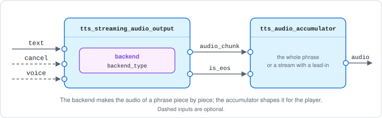
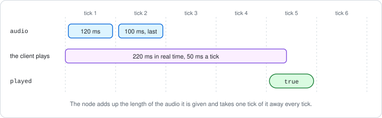
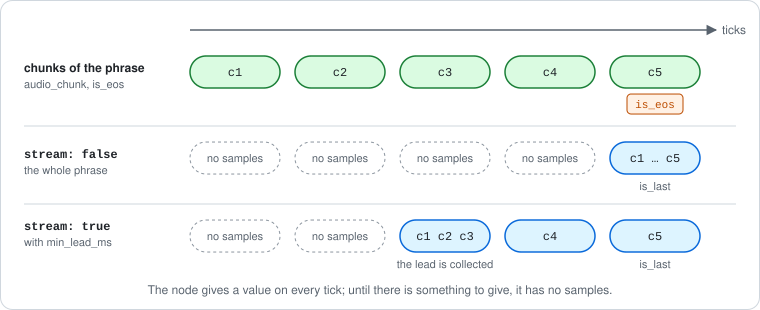
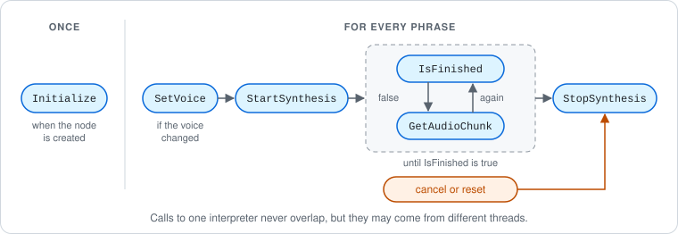

# TTS module

The `tts` module turns text into speech. The synthesis engine is a *backend* that the node config picks by name.
Each backend lives in a directory of its own and registers itself, so the code of the module does not know the
backends. This repository has two: [vits](#the-vits-backend), a neural synthesis of Russian, and
[pre_synthesized](#the-pre_synthesized-backend), which plays recordings made in advance.
[Adding a backend](#adding-a-backend) explains how to plug in another engine.

Build the module with `MODULES=tts`. Every backend has a build option in its `backend.cmake`:
`USE_VITS_BACKEND` (off by default) and `USE_PRE_SYNTHESIZED_BACKEND` (on by default). The build fails when no
backend is enabled.



## Nodes

### tts_streaming_audio_output

Text in, audio out.

| Port | Type | What it carries |
|---|---|---|
| input `text` | `string` | one phrase per tick; an empty string means no new phrase. A phrase that arrives while another one is synthesized waits in a queue |
| input `cancel`, optional | `bool` | `true` drops the phrase being synthesized and the queued ones. A text that comes in the same tick is not dropped: it is the next phrase and starts a tick after the `is_eos` of the cancelled one |
| input `voice`, optional | `string` | the voice of the next phrases; an empty string is the configured voice. A phrase that has started keeps its voice, and an unknown voice is reported to stderr and replaced with the configured one |
| output `audio_chunk`, batch | `vector<float>` | the pieces of the phrase as the backend returns them |
| output `is_eos` | `bool` | `true` once per phrase, when it ends: finished, failed, cancelled or dropped by a reset |

```yaml
nodes:
  - name: tts
    type: tts_streaming_audio_output
    inputs: {text: text, cancel: cancel_synthesis, voice: voice}
    outputs: {audio_chunk: audio_chunk, is_eos: is_eos}
    params:
      backend_type: pre_synthesized   # required: the backend name
      tts_interpreter_params:         # required: the backend's own params
        metadata_path: metadata.json
        audio_files_dir: audio
      # optional: synthesize in a thread pool of model_environments
      inference_strategy: {type: wait_till_inferring, thread_pool_name: tts_pool}
```

With an unknown `backend_type` the graph is not built: the error lists the backends of the build.

By default a phrase is synthesized in a [node loop](../../lib/node/README.md#loop) on the threads of the graph. With
`inference_strategy` as above it is synthesized in a thread pool
[environment](../../lib/runtime/README.md#environments), and a tick only takes the chunks that are ready.

### tts_audio_accumulator

Collects the chunks of a phrase for the player.

| Port | Type | What it carries |
|---|---|---|
| input `audio_chunk`, batch | `vector<float>` | the chunks from `tts_streaming_audio_output` |
| input `is_eos` | `bool` | the end of the phrase |
| output `audio` | `SynthesizedAudio` | the samples, their `sample_rate` and `is_last`, which marks the end of the phrase |

```yaml
  - name: tts_audio
    type: tts_audio_accumulator
    inputs: {audio_chunk: audio_chunk, is_eos: is_eos}
    outputs: {audio: audio}
    params:
      stream: false       # false: the whole phrase at its end; true: the pieces as they arrive
      min_lead_ms: 0      # with stream: how much audio to collect before the first piece
      sample_rate: 16000  # the rate of the backend output; the node does not resample
```

### tts_playback_timer

Counts when the client finishes playing a phrase. The graph does not hear the speaker: the node adds up the length
of the audio that came from `tts_audio_accumulator` and assumes that the client plays every chunk at once and in real
time. A graph uses it to do something after the reply has been heard, for example to listen again after a question.



| Port | Type | What it carries |
|---|---|---|
| input `audio` | `SynthesizedAudio` | the audio from `tts_audio_accumulator` |
| output `played` | `bool` | `true` in the tick where the playback of a phrase ends, `false` in every other tick |
| output `playing`, optional | `bool` | `true` from the tick of the first chunk while the client has audio left to play after the tick, and `playing_tail_ms` after that |

```yaml
  - name: reply_playback
    type: tts_playback_timer
    inputs: {audio: audio}
    outputs: {played: played, playing: playing}
    params:
      tick_ms: 50          # required: the time of one tick of the graph, the length of the microphone chunk
      tail_ms: 0           # added to the length of a phrase: the delay of the sound device
      playing_tail_ms: 0   # playing after the end of the audio: the delays of the speaker and the microphone, the echo
```

`playing` joins the phrases of a reply into one stretch while each pause of the synthesis, counted from the end of
the audio the client has, is not longer than `playing_tail_ms`; a longer pause ends it until the next audio. Without
audio, as with a synthesis stub, it is never `true`. A graph that gives the reply to the synthesis itself reads it in
the next tick, through a recursive output: then it is true exactly in the ticks whose microphone audio may hold the
reply.

The lead-in is for a synthesis that is slower than real time: without it the player catches up with the synthesis,
and the phrase breaks up.



## The vits backend

Neural synthesis of Russian on ONNX Runtime. The backend prepares the text itself: it reads out numbers, units and
abbreviations, puts the stresses and «ё», picks the reading of homographs and reads English words. Then acoustic
models of the VITS family turn the text into sound and give it out in a stream. Build the backend with
`USE_VITS_BACKEND=ON`; it needs `ONNXRUNTIME_ENABLED=ON`.

```yaml
backend_type: vits
tts_interpreter_params:
  models_path: models               # required: the acoustic models, relative to the model part
  text_path: text/ru                # required: the data of the text preparation
  voice: voice_1                    # required: the voice until the `voice` input names another
  voices: {voice_1: 0, voice_2: 1}  # required: a voice name -> its row in the table of speakers of the models
```

The other keys; a key that is not listed here is an error:

| Key | Default | What it is |
|---|---|---|
| `threads` | 1 | the threads of each model |
| `optimization_level` | `basic` | the graph optimization of ONNX Runtime: `disable`, `basic`, `extended` or `all` |
| `onnx_environment` | none | the name of a shared ONNX environment; without it the backend has one of its own |
| `speed` | 1.0 | from 0.25 to 4; 2 speaks twice as fast |
| `noise_scale`, `noise_scale_w` | those of `voice.json` | the noise of the acoustic models |
| `gain_db` | 0 | from -60 to 40, on top of the gain of the voice |
| `max_text_chars` | 100000 | a longer text is cut |
| `max_sentence_chars` | 180 | from 20 to 400: a longer sentence is cut into pieces |
| `sentence_pause_ms`, `clause_pause_ms`, `word_pause_ms` | 500, 150, 20 | the pause after a sentence, after a piece cut at a comma, colon or dash, and after a piece cut at a space |
| `verify_dictionaries` | false | check the checksums of the dictionaries at load |
| `mmap_models` | false | the models are in the ORT format and are used in place from the mapped files |
| `local_debug_enabled` | false | print the time of every stage to the log |
| `homograph_strong_confidence`, `homograph_mild_confidence` | 0.9 | from 0 to 1: how probable the homograph model must find a reading to choose it against the prevailing one of `homographs_priors.tsv`. The first key is for words whose reading prevails strongly, the second for words whose reading prevails mildly |

- The audio comes at `model_sample_rate` of `voice.json`. Set the same `sample_rate` in `tts_audio_accumulator`.
- For slow speech the sentence limit is lower. The limit applied is the smaller of `max_sentence_chars` and
  400·√min(speed / max(length_scale of the voice, 1), 1), and at least 20: the letters take length_scale / speed of
  the time, the blanks and marks 1 / speed.
- A negative speaker number is an error of the params. A number beyond `n_speakers` of `voice.json`, when the
  package states it, is an error at load.

### The package

The models and the data of the backend are a model part:

```
config.yaml   the graph: tts_streaming_audio_output -> tts_audio_accumulator
models/       bert.onnx text_qf0.onnx full_text.onnx length_regulator.onnx flow.onnx decoder.onnx
              (fp32, the weights in <name>.onnx.data next to each), bert_vocab.txt, voice.json,
              question_rules.json (if voice.json sets use_questions_rules);
              pause_predictor.onnx, the optional pause model
text/ru/      stress.dict yo.dict stress.onnx stress_vocab.txt homographs.onnx homographs_vocab.txt
              homographs.dict homographs.tsv stress_overrides.tsv yo_extra.tsv hyphen.tsv e_to_eh.tsv
              no_pause_words.txt nouns.tsv units.tsv abbreviations.tsv readings.tsv words.tsv government.tsv
              english.dict homographs_priors.tsv;
              optional: morph.dict, homographs_variants.tsv and homographs.data, homographs2.onnx and
              homographs2_vocab.txt
NOTICE        the sources and licenses of the data by file
licenses/     the full texts of the licenses
```

- **Required:** the models, `bert_vocab.txt`, `voice.json` (and `question_rules.json` when it asks for the rules),
  `stress.dict`, `nouns.tsv`, `units.tsv`, `abbreviations.tsv`, `words.tsv`, `government.tsv` and `readings.tsv`.
  Without any other file its step is skipped.
- **`homographs_priors.tsv`** lists the prevailing readings of homographs: the other reading of such a word is taken
  only when the model is sure of it.
- **Optional data:** `morph.dict` is the morphological dictionary; `homographs_variants.tsv` and `homographs.data`
  are the bigger homograph model and its weights; `homographs2.onnx` and `homographs2_vocab.txt` are a second
  homograph model next to the first one.
- **The pause model** puts a pause after a word where the text has none and the model gives one a probability above
  `pause_threshold` of `voice.json` (0.7 if it is absent). It matters for long stretches without punctuation.

### Limits

- Russian only.
- A sentence longer than `max_sentence_chars` is cut.
- The stress of a word that is neither in the dictionaries nor in the tables comes from a small model and may be
  wrong.

## The pre_synthesized backend

This backend has no model: it plays recordings made in advance and finds them by the text of the phrase.

```yaml
backend_type: pre_synthesized
tts_interpreter_params:
  metadata_path: metadata.json   # required: the list of phrases
  audio_files_dir: audio         # required: the directory with the WAV files
```

`metadata.json` is an array with one entry per phrase:

```json
[
  {"text": "Включаю свет", "file": "light_on.wav"},
  {"text": "Включаю свет", "file": "light_on_second.wav", "voice": "second"}
]
```

- Both paths are relative to the model part.
- A phrase is found by its text. The case of Russian letters does not matter (the case of Latin ones does), and
  every character that is not a Russian or Latin letter counts as a space.
- An entry without `voice` belongs to the configured voice. An entry with `voice` is used once that name has come to
  the `voice` input.
- A phrase with no entry gives no audio: it ends at once with `is_eos`.
- The first channel of the file is returned as it is, without resampling. Record all the files at one rate and set
  it as `sample_rate` of `tts_audio_accumulator`.

## Backend contract

A backend implements `ITtsInterpreter` from
[interpreter.h](internal/giga_edge/modules/tts/interpreter/interpreter.h).



- `Initialize(params, data_reader, environments)` is called once, when the node is created. `params` holds what the
  backend's own `ParseConfig` returned for `tts_interpreter_params`; `std::any_cast` it to the type of the backend.
  Read model files through `data_reader`: it handles model archives and the paths of the submodel. Return `false`
  or throw on failure: the node is then not created.
- `StartSynthesis(text)` starts a phrase; `text` is never empty. An exception from it or from `GetAudioChunk` ends
  the phrase with `is_eos`: the node calls `StopSynthesis` and goes on with the next phrase.
- `GetAudioChunk()` returns the next piece of the phrase and is called while `IsFinished()` is false. The audio is
  mono float PCM in [-1, 1] at the output rate of the backend (set the rate in the params of the backend). An empty
  chunk is allowed.
- `IsFinished()` says that the whole phrase has been returned.
- `StopSynthesis()` drops the phrase. It is called after a finished phrase, on a cancel and on a reset, and it may
  be called when no phrase has started. The next `StartSynthesis` must work after it.
- `SetVoice(voice)` sets the voice of the next phrases, never of the started one; an empty string is the configured
  voice. For an unknown voice return `false` and keep the configured one. By default a backend has no voices.
- `IsReady()` says whether `Initialize` succeeded.

Calls to one interpreter never overlap, but they may come from different threads: the thread of the graph tick in
the sync mode, a pool worker in the async mode (a cancel and a reset wait for the worker first). Several
interpreters may live in one process, for example in several nodes, or while a new submodel version is loaded next
to the old one. So keep no unguarded global state.

Run neural networks through the interpreters of the `model` module (`MakeInterpreter`: ONNX Runtime, TFLite and
others, with the shared `model_environments`), not through a runtime wrapper of the backend's own.

## Adding a backend

For a backend `<name>`:

1. In `internal/giga_edge/modules/tts/interpreter/backends/<name>/`:
   - `params.h` with the params struct;
   - `interpreter.h` with the class derived from `ITtsInterpreter` and, at global scope after it,
     `REGISTER_TTS_BACKEND(<name>, <Params>, <Interpreter>)`.
2. In `src/interpreter/backends/<name>/`:
   - `params.cpp` with `template<> <Params> ParseConfig(const YAML::Node&)`: check the params there and throw with
     a clear message;
   - the implementation;
   - `backend.cmake` with the build option, `target_sources(tts_module ...)`, the dependencies,
     `list(APPEND TTS_BACKENDS <name>)` and the tests of the backend under `if(TARGET tts_tests)`;
   - `module.cmake`, optional: it appends to `TTS_MODULE_ARGS` when the backend changes how the module is
     registered (`DEFAULT`, `PACKAGES`, `PROVIDES`; see `register_module` in `cmake/Module.cmake`).
3. Tests in `tests/src/interpreter/<name>/` and `tests/src/nodes/tts_streaming_audio_output/<name>/`.

The shared files of the module do not change, and a backend left out of a distribution is just a missing directory.
For small examples, see the `pre_synthesized` backend and `tests/src/interpreter/fake/interpreter.cpp`, a minimal
backend registered from the test binary.
